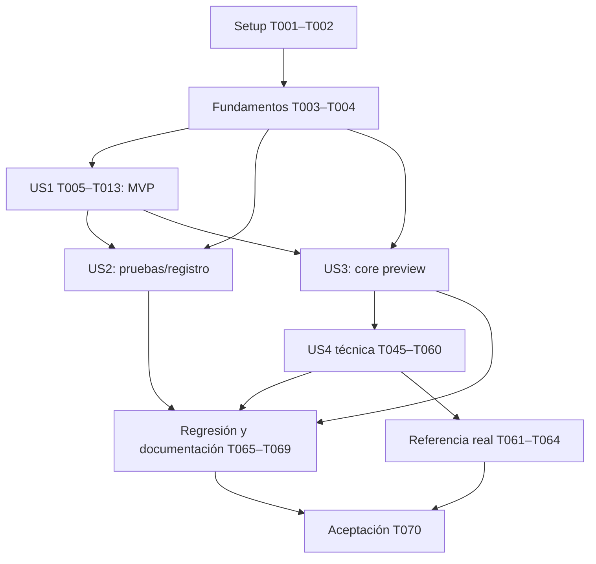

# Tasks: Anotaciones despejadas y placas legibles

**Input**: [plan.md](plan.md), [spec.md](spec.md), [research.md](research.md), [data-model.md](data-model.md), [contracts/](contracts/), [evaluation-protocol.md](evaluation-protocol.md) y [quickstart.md](quickstart.md).
**Checkout / rama**: checkout principal; `feature/007-anotaciones-placas-legibles`. Preservar contenido e índice existentes, contratos históricos006, modelos/pesos/umbrales y configuración privada.
**Tests**: Requeridos explícitamente por spec/plan y Constitución IV. Escribir y ejecutar las regresiones antes de cada cambio de comportamiento; documentar rojo -> verde. Los fixtures no acreditan ganancia de exactitud real.
**Organization**: Fases por historia; rutas relativas al checkout principal. Usar `app/` para backend, no crear otro proyecto backend. Este documento registra el estado de implementación; la aceptación real de OCR se mantiene separada.

## Format: `[ID] [P?] [Story] Description`

Cada línea empieza con checkbox e ID local a007. [US1]–[US4] aparece en todas las tareas de historia y no en Setup/Foundational/Polish. [P] indica solo tareas que pueden ejecutarse simultáneamente una vez satisfechas sus dependencias, con archivos de salida distintos; no autoriza iniciar trabajo dependiente ni editar el mismo archivo a la vez. Los IDs mencionados como pruebas que deben fallar antes de implementar no son dependencias inversas.

Las restricciones entre comillas angulares se copian del modelo de datos; el esquema OpenAPI y las recetas versionadas completan las comprobaciones, no se dejan para decidir al implementar. No crear commits ni cambiar ramas para completar una tarea.

## Phase 1: Setup — línea base y evidencia controlada

Registrar el estado inicial y preparar datos sintéticos que no incorporen imágenes privadas.

- [X] T001 Registrar la línea base de esta implementación en `specs/007-anotaciones-placas-legibles/validation.md`: checkout/rama solicitados, cambios previos preservados, versiones y comandos existentes de backend/frontend/navegador; mantener explícitos los pendientes 006/T067 y 006/T068 y no modificar pesos, modelos, umbrales ni configuración privada.

- [X] T002 [P] Crear el generador `tests/e2e/build_annotation_fixtures.py` y sus artefactos sintéticos bajo `frontend/e2e/fixtures/annotations/`: >=10 escenas (>=3 con21 detecciones), IDs de1/2/3 cifras, cajas pequeñas/solapadas, las13 clases del catálogo y desconocidas, original limpio/anotada con texto deliberadamente distintos y >=30 placas/ROI con píxeles distinguibles. No copiar imágenes privadas ni sobrescribir fixtures de006.

**Checkpoint**: Línea base y fixtures listos; nada acredita todavía la mejora.

## Phase 2: Foundational — fixtures y compatibilidad compartida

Preparar inyección/relojes/barreras y guardas antiguas; estas cuatro tareas de preparación preceden la implementación de historias.

- [X] T003 [P] Preparar fixtures inyectables de007 en `tests/annotation_fixtures.py` y `frontend/e2e/annotation-scenarios.ts`, conectadas con `tests/conftest.py` y `tests/e2e/serve_frontend_test_api.py`: dos propietarios sintéticos, relojes/barreras controlables, adapters contados y todos los stores bajo TemporaryDirectory; no leer ni alterar runtime privado. Requiere T001, T002.

- [X] T004 [P] Añadir guardas de compatibilidad de006 en `tests/contract/test_annotation_compatibility.py` usando sus fixtures existentes: original canónico protegido, anotada antigua todavía disponible, detección/enriquecimiento de imagen, campos previos de placa y video/conteo; ejecutar las guardas y registrar baseline antes de modificar comportamiento. No exigir todavía la nueva ruta/provenance. Requiere T001, T002.

**Checkpoint**: Fundamentos listos; usar las pruebas de cada historia antes de cambiarla.

## Phase 3: US1 — Escena despejada e identificación externa (P1, MVP)

Prueba independiente: diez escenas, tres con >=21 detecciones, originales/anotadas distinguibles; cero números/glifos sobre imagen y selección por identidad mediante puntero, teclado y toque en360/768/1440 y200%.

- [X] T005 [P] [US1] Escribir primero las regresiones en `frontend/tests/features/image-analysis/context.test.tsx`: foco válido > puntero válido > selección válida; leave/blur antiguo no borra un contexto más reciente, hover no cambia ficha ni llama procesamiento, activación sí selecciona y reemplazo/reset/identidad/TTL borra contexto. Ejecutar y comprobar fallo antes de T007. FR-002–004. Requiere T003, T004.

- [X] T006 [P] [US1] Escribir primero `frontend/e2e/image-analysis.unobstructed.spec.ts` con el original limpio y anotada rotulada de T002: demostrar fondo por píxeles y cero números/glifos dentro de imagen, no uso de anotada, IDs enteros, lista/toque/teclado, tres viewports/texto200%, escenas densas y contexto/ficha sin cambio implícito; medir <1s con reloj monotónico. Ejecutar en rojo antes de T008–T012. SC-001/002. Requiere T003, T004.

- [X] T007 [US1] Ampliar `frontend/src/features/image-analysis/imageAnalysisReducer.ts` y `types.ts` con SceneInteraction: «generation, sourceId, selectedDetectionId existentes; añadir focusedDetectionId y hoveredDetectionId opcionales» y «contextualDetectionId = foco válido de la fuente ?? puntero válido ?? selección válida.» Aplicar «En blur/leave se borra únicamente el contexto de ese control, no uno más reciente.»; validar pertenencia a fuente vigente y no cambiar selección por hover/foco. Requiere T005, T006.

- [X] T008 [P] [US1] Adaptar `frontend/src/features/image-analysis/useImageAnalysis.ts` y sus pruebas de medios/lifecycle para usar original canónico como fuente de la escena/crops; no descargar anotada para el visor007 ni usar como fallback el upload/anotada. Conservar API/artefactos históricos, lista/resultados autorizados ante fallo del original y reintento de original sin otra inferencia; mantener aborto, TTL y retirada por rechazo. Requiere T007.

- [X] T009 [P] [US1] Cambiar `frontend/src/features/image-analysis/AnnotatedImageViewer.tsx` para dibujar contornos sobre el original con geometría de006: todos los actores válidos; «Detección sin elegibilidad: contorno no interactivo; leyenda con nombre sin ficha falsa.» Solo elegibles son botones; quitar spans numéricos y cualquier glifo textual sobre la escena. Sin original disponible no dejar controles flotando. Requiere T007.

- [X] T010 [P] [US1] Crear `frontend/src/features/image-analysis/DetectionContext.tsx` para la banda exterior: una detección contextual, nombre/clase e identificador con nowrap, distinción contextual/seleccionada e instrucciones sin contexto. Anunciar selección, no cada movimiento del puntero; no introducir tooltips sobre imagen ni robar foco. Requiere T007.

- [X] T011 [US1] Integrar contexto/selección en `frontend/src/features/image-analysis/ImageWorkspace.tsx` y `DetectionList.tsx`, conectando eventos de escena/lista y DetectionContext. Aplicar «hover/leave/focus/blur solo cambian contexto. Clic/Enter/Espacio/toque explícito cambia selección; no se llama procesamiento por hover.»; cerrar ficha no roba foco y cambios de fuente invalidan los tres IDs. Requiere T008, T009, T010.

- [X] T012 [US1] Ajustar `frontend/src/features/image-analysis/image-analysis.css` para banda en flujo, números nowrap, nombres envolventes y ausencia de content textual/✓ sobre escena; conservar proporción, foco visible, targets equivalentes44px y 360/768/1440 con texto200%, sin scroll horizontal de página ni alterar LineEditor. Requiere T011.

- [X] T013 [US1] Ejecutar las pruebas T005/T006 y recorridos imagen de006, revisar capturas sintéticas y registrar resultados/latencia contextual <1s en `specs/007-anotaciones-placas-legibles/validation.md`. Cerrar US1 solo con10 escenas/3densas, cero etiquetas sobre imagen y selección inequívoca por teclado/toque. No declarar todavía colores o mejora OCR entregados. Requiere T012.

**Checkpoint**: MVP US1 verificable sin US2/US3/US4; no afirmar todavía colores ni mayor exactitud.

## Phase 4: US2 — Colores por clase y leyenda accesible (P1)

Prueba independiente: matriz del catálogo de13 clases y fallback, unicidad/estabilidad de tokens, coherencia entre cuatro superficies y contraste/estados reales sobre fondos claros/oscuros; sin cambiar elegibilidad.

- [X] T014 [P] [US2] Escribir primero `frontend/tests/features/image-analysis/classPresentation.test.ts`:13 tokens contractuales únicos, estabilidad entre análisis/órdenes/subconjuntos, normalización de nombre sin modificar IDs, catálogo de clases por defecto cubierto, desconocida neutral/nombre escapado y elegibilidad exclusivamente del servidor. Fallo antes de T016. FR-005/006. Requiere T003, T004.

- [X] T015 [P] [US2] Escribir primero `frontend/e2e/image-analysis.classes.spec.ts` con matriz de clases y fondos blanco/negro: medir estilos reales de contorno/foco, coherencia escena/lista/leyenda/ficha y estados distinguibles sin solo color, texto200%, toque y cajas pequeñas/solapadas; no certificar WCAG por un color fijo o snapshot. Fallo antes de T017–T019. SC-003. Requiere T003, T004.

- [X] T016 [US2] Crear `frontend/src/features/image-analysis/classPresentation.ts` con la tabla exacta de `contracts/frontend-interactions.md`: classKey «class_name.trim().toLowerCase(); solo presentación, no modifica identidad del DTO»; label «Traducción del catálogo; para desconocidas, nombre recibido escapado como texto»; color «Valor fijo del registro en frontend-interactions.md»; known «true solo si está en el registro explícito»; eligible «Siempre procede del servidor; jamás se infiere de color/nombre». Cubrir las13 clases, fallback #64748B y exigir extensión/prueba al incorporar una clase conocida configurada; no usar módulo ni orden. Requiere T014, T015.

- [X] T017 [US2] Crear `frontend/src/features/image-analysis/ClassLegend.tsx` con nombres/muestras de las clases presentes, incluidos actores no enriquecibles y desconocidos, usando el mismo registro. La leyenda no activa enriquecimiento ni filtra/oculta detecciones; mantener información mediante texto y no solo color. Requiere T016.

- [X] T018 [US2] Aplicar el registro compartido y ClassLegend en `frontend/src/features/image-analysis/AnnotatedImageViewer.tsx`, `DetectionList.tsx`, `VehicleDetails.tsx` e `ImageWorkspace.tsx`; mismo color/nombre por clase en las cuatro superficies, sin cambiar identidad, elegibilidad, ficha o geometría. Requiere T011, T016, T017.

- [X] T019 [US2] Definir estilos de clase/estado en `frontend/src/features/image-analysis/image-analysis.css`: trazo de clase preservado más auxiliares claro/oscuro sin relleno; normal continuo, hover enfatizado, selección doble y foco con halo distinguible. Texto exterior>=4.5:1 y controles/foco>=3:1; no poner glifos sobre escena ni ampliar hitboxes. Requiere T018.

- [X] T020 [US2] Ejecutar T014/T015 con catálogo completo, tres viewports y fondos claros/oscuros; revisar capturas y registrar evidencia SC-003 en `specs/007-anotaciones-placas-legibles/validation.md`. Verificar otra vez US1, clases nuevas/no reconocidas y que color nunca cambia elegibilidad. Requiere T013, T019.

**Checkpoint**: US1/US2 integradas y verificadas; US3/US4 conservan su propio cierre.

## Phase 5: US3 — Comparar placa original y procesada (P1)

Prueba independiente: >=30 placas localizadas con fuente/ROI inequívocos, GET autenticado sin inferencias, comparación/zoom, estados y retirada correctos; p95 frío<=2s y plazo total<=10s con condiciones registradas.

- [X] T021 [P] [US3] Añadir primero pruebas del GET preview en `tests/contract/test_plate_preview_contract.py`: seguridad, IDs/perfil, PNG, cabecera obligatoria/tipada, no-store en éxito/errores, códigos contractuales y referencias alcanzables de metadata en OpenAPI documentado/generado. Limitar esta aceptación a preview; la extensión de provenance en resultados se verifica con US4. Ejecutar en rojo antes de T026–T033. FR-009/017; Constitución I/II. Requiere T003, T004.

- [X] T022 [P] [US3] Añadir primero `tests/unit/test_plate_preview_geometry.py` y `tests/unit/test_plate_display_profile.py` con ROI distinguibles, cajas fraccionarias/bordes/EXIF1–8, equivalencia frontend, fuente sin mutación, límites/dimensiones/transformación, perfil inaplicable y PNG sin EXIF/texto heredado; no afirmar recuperación de caracteres por contraste. Ejecutar en rojo antes de T027/T028. SC-004. Requiere T003, T004.

- [X] T023 [P] [US3] Añadir primero `tests/unit/test_plate_preview_store.py`: clave con dueño/fuente/job/detección/perfil, single-flight real con barreras, cupo1/cero cola, deadline compartido no renovable, LRU8/16MiB/entrada2MiB, TTL absoluto, consumidores abandonados, expulsión y cupo retenido por hilo tardío. Ejecutar en rojo antes de T029/T031/T032. FR-018; SC-008. Requiere T003, T004.

- [X] T024 [P] [US3] Añadir primero `tests/integration/test_plate_preview_access.py` y `tests/integration/test_plate_preview_lifecycle.py`: dueño/ajeno/sin clave, job no imagen/no completed, read/unreadable/failed con bbox y not_detected, no 404 por placa ausente, TTL entre lectura/cache/proceso/entrega, retiro de consumidores y CORS. Usar barreras/reloj, contador de modelos=0 por GET y limpieza sin tráfico/cierre. Rojo antes de T030–T034. FR-012/017/020. Requiere T003, T004.

- [X] T025 [P] [US3] Añadir primero `frontend/tests/services/platePreviewClient.test.ts` y `frontend/tests/features/image-analysis/platePreviewLifecycle.test.tsx` y `frontend/tests/features/image-analysis/PlateComparison.test.tsx`: identidad/header ausente o inválido, MIME/bytes/dimensiones, cuerpo y decode suspendidos, TTL/deadline completo, cambios/reset/errores y revocación; no POST ni restauración tardía. Comprobar controles Original/Procesada, zoom proporcional, accesibilidad y cero peticiones al alternar; usar temporizadores controlados; rojo antes de T035–T038. SC-005/007. Requiere T003, T004.

- [X] T026 [US3] Definir metadata estricta en `app/domain/schemas.py` según OpenAPI007: version «1»; source_id/enrichment_job_id «Identificadores de la misma operación, no vacíos; cliente compara con su contexto» y longitud1..128; detection_id «Entero >=1, correspondiente al resultado/vehículo de origen»; profile_id «display-contrast-v1; versión desconocida no se interpreta como compatible»; input_size «width/height >=2 del recorte ORIGINAL de placa»; output_size «width/height >=2, <=2048 y producto <=2 millones»; original_bbox «Coordenadas enteras globales [x_min,x_max) x [y_min,y_max) del original canónico»; applied_steps «Secuencia real: grayscale, resize_integer solo si scale>1, clahe»; original_to_processed «Seis números finitos, matriz 2x3 local al ROI: [s,0,0,0,s,0], s entero 1..4»; expires_at «UTC, min(vigencia fuente,job), nunca ampliada por caché ni reintento». Rechazar campos extra; comprobar input_size=diferencias de bbox y output_size=input_size*s. Requiere T021, T022.

- [X] T027 [US3] Crear `app/services/plate_geometry.py` para obtener ROI desde original canónico y cajas autorizadas, equivalente a `frontend/src/utils/imageGeometry.ts`: «nearest si abs(value-nearest)<=2*epsilon*max(1,dimensión); resto truncado»; clamp vehicular y rechazo de degeneradas, global=origen vehículo+local. No estimar localización, esquinas ni aceptar bbox del cliente; cubrir fracciones/IEEE/EXIF y límites de T022. Requiere T026.

- [X] T028 [P] [US3] Crear perfil visual puro/versionado display-contrast-v1 en `app/services/plate_profiles.py`: gris, ampliación entera isotrópica1..4 buscando alto64 dentro de cotas y CLAHE(2,8x8); sin deskew/padding/bilateral ni modelos. Entrada/salida8bits; si escala1 no cabe, lado<2 o intensidad uniforme, no aplicable; comprobar PNG<=2MiB/lado2048/2Mpx y metadata de pasos/matriz reales. Conservar original y baseline006 sin alterar; usar T022 en verde. Requiere T026, T027.

- [X] T029 [P] [US3] Crear `app/services/plate_preview_store.py` con clave «(owner_key_id, source_id, enrichment_job_id, detection_id, profile_id)» y entrada «PNG bytes + metadata juntos, coste en bytes, último acceso solo para expulsión LRU; expires_at absoluto no se renueva». Aplicar «8 entradas y 16 MiB totales, PNG <=2 MiB por entrada, metadata ASCII <=2048 bytes, salida <=2048 por lado y <=2 Mpx»; «No se almacena un frame decodificado completo en la caché». Estados «absent -> processing -> ready; processing -> abandoned/failed/expired; ready -> evicted/expired» y expulsión antes de exceder cotas; sin tabla/job/archivo nuevo. Requiere T023, T026, T027.

- [X] T030 [P] [US3] Añadir consulta tipada de resultado por detection_id real en `app/services/enrichment_job_store.py` y resolución en `app/services/plate_preview_service.py`: mismo dueño, job completed/source_kind=image, fuente vigente, clase/identidad coincidentes, track_id null y bbox_relative saneada. Admitir read/unreadable/failed localizados; placa ausente/inaplicable422, ajeno/desconocido404, vencido conocido410 y job no listo/no imagen409. No depender de índice/paginación ni acceder al filesystem desde la ruta HTTP. Requiere T024, T026, T027.

- [X] T031 [US3] Orquestar single-flight/cómputo en `app/services/plate_preview_service.py` y `plate_preview_store.py`: «Un cupo de cálculo por proceso y cero cola para claves diferentes»; consumidores/token/desconexión/deadline y «deadline compartido del cálculo no se amplía al unirse otro». Threadpool acotado, servidor8s desde admisión, 429/Retry-After1 por otra clave y 504 al cortar; compartir misma clave sin reinferir. Si todos se retiran antes de terminar, no guardar/entregar; retener permiso CPU hasta finalizar el hilo real, aun tras timeout, y no mantener locks durante decodificación/transformación. Requiere T028, T029, T030.

- [X] T032 [US3] Completar revalidación/publicación coordinada en `app/services/plate_preview_service.py` y purga/cierre en `app/services/plate_preview_store.py`: comprobar dueño/fuente/job/menorTTL antes de lectura, en hits y antes de cachear/entregar; descartes de retiros/timeout/expired nunca publican tarde. Conservar entrada ya entregada solo hasta TTL/cotas; janitor<=2s y close limpian RAM sin residuos en disco. Una selección repetida no renueva TTL; recalcular después de expulsión es permitido sin inferencias. Requiere T031.

- [X] T033 [US3] Exponer GET `/api/v1/enrichment-jobs/{enrichmentJobId}/detections/{detectionId}/plate-preview` en `app/api/routes/enrichment_jobs.py`, inyectar servicio/caché/janitor/cierre en `app/core/lifespan.py` y añadir solo expose_headers=['X-Plate-Preview-Metadata'] a CORS en `app/main.py`. Principal existente, único profile=display-contrast-v1; PNG+JSONASCIIheader<=2048B, no-store en todas las respuestas, errores seguros contractuales; no aceptar cuerpo/receta/coordenadas/URL/texto ni nuevo endpoint de cancelación. Mantener orígenes, métodos, autenticación y límites previos. Requiere T021, T024, T032.

- [X] T034 [US3] Instrumentar preview reutilizando `app/services/inference_metrics.py` desde `app/services/plate_preview_service.py` y permitir solo campos seguros necesarios en `app/core/logging.py`: request_id/job_id/source_type=image, profile_id de catálogo, duración/RSS inicial/final/máximo y desenlace real completed/abandoned/expired/failed; sin imágenes, matrículas, claves o rutas. Conservar semántica atómica 006/T083 y medición por cuadro de video; añadir aserciones en `tests/unit/test_plate_preview_metrics.py`. Requiere T033.

- [X] T035 [US3] Añadir método preview compatible a `frontend/src/services/apiClient.ts` y tipos/parser en `apiTypes.ts`, reutilizando consume/señales/deadlines: validar todas las restricciones de T026, header JSONASCII<=2048B, identidad fuente/job/detección/perfil/ROI, PNG<=2MiB mediante consumo acotado sin confiar solo en Content-Length, decode/dimensiones y TTL antes de publicar. Presupuesto monotónico10s incluye headers+cuerpo+decode; no esperar cuerpo de401/404/410 ni enviar clave fuera del origen. Mantener firmas/rutas antiguas y errores seguros. Requiere T025, T026, T033.

- [X] T036 [US3] Crear `frontend/src/features/image-analysis/usePlatePreview.ts` con «generation, selectionKey(source+job+det+profile), status, url?, metadata?, errorCode?, view(original|processed), zoom(1|2|4), deadline monotónico» y estados «idle -> preparing -> available | not_applicable | failed; desde cualquiera -> expired/disposed». Aplicar «Una operación por selectionKey» y «Mantener como máximo la URL procesada de la selección activa»; abortar cuerpo/decode/timer y revocar al cambiar selección/fuente/job/credencial/reset/TTL; retry solo GET y ningún cambio de modo/zoom llama servidor. Original compartido sigue en lifecycle006. Requiere T035.

- [X] T037 [US3] Crear `frontend/src/features/image-analysis/PlateComparison.tsx`: Original inicial, preparación automática al seleccionar una placa válida, Original/Procesada con nombres/aria-pressed, perfil/tratamientos descritos y zoom1x/2x/4x proporcional con scroll interno accesible; fallos/noaplicable no eliminan original válido. Mostrar origen OCR conocido solo si lo entrega el contrato; ausencia significa desconocido, nunca inferred desde vista/used_enhancement. Sin editar fuente ni presentar interpolación como detalle recuperado. Requiere T036.

- [X] T038 [US3] Integrar comparador/contexto de job y expiry en `frontend/src/features/image-analysis/VehicleDetails.tsx`, `ImageWorkspace.tsx` e `image-analysis.css`; retener crop original fiel, no GET antes de bbox válida ni para not_detected, permitir unreadable/failed localizados y mantener atributos/lectura independientes. Cambio de intento/job con la misma detección invalida derivada antigua. Mantener selección/foco y geometría de006, sin repetir análisis al alternar/reintentar. Requiere T011, T037.

- [X] T039 [US3] Ejecutar y completar guardas de T021–T024 y métricas en `tests/integration/test_plate_preview_lifecycle.py`: carreras reales al publicar/cachear/entregar, health/cancelación atendidos mientras procesamiento bloqueado por barrera, cupo retenido tras504/desconexión, cuerpos PNG correctos y cache-hit reautorizado. Usar memoria/tiempo reales solo donde corresponde y reloj controlado para vencimiento; no cambiar producción para forzar flags ready. Requiere T034.

- [X] T040 [US3] Ejecutar y completar T025 en `frontend/tests/features/image-analysis/platePreviewLifecycle.test.tsx`: estados diferenciados, identidad/URL única, imagen equivocada de otra fuente rechazada, reset/selección/credencial/job durante descarga y decode, metadata o CORS incompatibles,401/404/410 inmediatos y conservación del original para409/422/429/504. Registrar cero POST extras y cero restauraciones tardías. Requiere T038.

- [X] T041 [US3] Añadir y ejecutar `frontend/e2e/image-analysis.plate-comparison.spec.ts` con API real de pruebas y adaptadores contados:>=30 placas/localizaciones distinguibles, píxeles/ROI/metadata correctos, lectura en sus cuatro estados, zoom/alternancia/reintento sin modelos ni POST extra, CORS expuesto en navegador y lifecycle con respuestas tardías. Probar tres viewports, teclado/toque y texto200%; no afirmar exactitud real mediante estos fixtures. Requiere T038, T039, T040.

- [X] T042 [US3] Medir en `frontend/e2e/image-analysis.plate-performance.spec.ts` y registrar en `specs/007-anotaciones-placas-legibles/validation.md`:30 placas válidas disponibles, serie fría con caché vaciada por mecanismo solo de pruebas y serie caliente separada, reloj monotónico desde selección hasta PNG correcto decodificado/renderizado; p95 nearest-rank=ceil(.95*N), para30 muestra29, objetivo<=2s y ningún intento local>10s. Fallos no cuentan como éxito rápido ni se excluyen para mejorar denominador. Requiere T041.

- [X] T043 [US3] Medir y registrar límites/purga en `tests/performance/test_plate_preview_resources.py` y `specs/007-anotaciones-placas-legibles/validation.md`: duraciones/RSS de proceso con condiciones explícitas, LRU/cotas cumplidas tras ciclos, sin retención creciente, derivadas vencidas purgadas<=2s sin tráfico y sin archivos nuevos. No atribuir RSS exclusivo a un job ni reemplazar métricas con aserciones que solo copian constantes. Requiere T039.

- [X] T044 [US3] Cerrar US3 en `specs/007-anotaciones-placas-legibles/validation.md` con T021–T043 verdes y matriz SC-004/005/007/008:30 comparaciones válidas, cuerpo/header/CORS, errores/lifecycle, tiempos, privacidad y regresión006. Si rendimiento o retirada no se ejecutaron/no pasan, dejar criterio pendiente; no declarar todavía ganancia OCR ni cerrar US4. Requiere T040, T041, T042, T043.

**Checkpoint**: Comparación y recursos verificados; no se atribuye ganancia de lectura a esta presentación.

## Phase 6: US4 — Procedencia y lectura más exacta con evidencia (P2)

Prueba independiente: baseline congelada y candidata con lógica sintética; aceptación real con reserva>=60(30degradadas+30control), >=5pp de mejora y sin empeorar coincidencia global/CER/falsas aceptadas. Sin referencias/gate superado, la capacidad permanece pendiente.

- [X] T045 [P] [US4] Congelar primero baseline-v1 en `tests/unit/test_plate_baseline_policy.py` contra `app/services/enrichment_processing.py` y `plate_quality.py`: lectura raw, retry solo ausente/confidence<retry_threshold, empate conserva raw, aceptación>=accept_threshold, giro0.5..15 y scale=max(1,min(4,64/height)) con round, cubic/CLAHE/pad8 vigentes. Golden pixels/llamadas contadas y casos límite impiden introducir denoise/cambiar redondeo; video conserva outputs. Ejecutar antes de refactor/políticas. FR-015/020. Requiere T003, T004.

- [X] T046 [P] [US4] Añadir primero `tests/contract/test_plate_provenance_contract.py` y `tests/unit/test_plate_provenance.py`: provenance ausente/null/legacy, metadata exacta para imagen, validación selected/attempted/read, JSON/SQL/respuestas sin textos descartados y canarios, bbox preservada en fallo de OCR. Validar operación results y referencias alcanzables en OpenAPI007. Rojo antes de T050–T053. FR-014/017; Constitución III. Requiere T003, T004.

- [X] T047 [P] [US4] Añadir primero `tests/unit/test_plate_candidate_profiles.py`: recetas de evaluation-protocol.md desde el mismo crop, límites incluyendo padding, uniformes/lado<2/block11 inaplicables, fuente no mutada, ausencia de giro/perspectiva/generación y perfil visual distinto del OCR. No usar nitidez/confianza sintética como prueba de acierto. Rojo antes de T054. Requiere T003, T004.

- [X] T048 [P] [US4] Añadir primero `tests/unit/test_plate_rescue_policy.py`: baseline read intacta, solo unreadable rescatable, máximo2 variantes nuevas, desacuerdo=>unreadable sin texto, acuerdo/empate por regla congelada, confianza real sin suma, intento procesado=>used_enhancement true y corte10s/TTL/cancel entre llamadas sin publicación parcial. Probar que baseline/video no se activan por petición/selector y métricas/cierre permanecen correctos. Rojo antes de T052/T055. FR-016/019/020. Requiere T003, T004.

- [X] T049 [P] [US4] Añadir primero `tests/unit/test_plate_evaluation.py` con oráculos pequeños distinguibles para coincidencia, CER y falsa aceptada, confianza alta incorrecta, predicción vacía sin localización, denominadores, selección no favorable, splits contaminados, duplicados/referencias ausentes y reporte sin texto/rutas/claves. Pruebas solo de lógica del evaluador, nunca PASS real de SC-006. Rojo antes de T056–T058. Requiere T003, T004.

- [X] T050 [US4] Añadir provenance opcional/null a `app/domain/schemas.py` con restricciones textuales de data-model: «version=1»; «policy_id: baseline-v1 | candidate-rescue-v1 | legacy-unknown»; «attempted_variants: lista única y ordenada de raw, legacy-retry-v1, bilateral-clahe-v1, bilateral-adaptive-v1; solo intentos realmente ejecutados»; «selected_variant: raw | legacy-retry-v1 | bilateral-clahe-v1 | bilateral-adaptive-v1 | none | unknown». Aplicar «Si plate.status != read: selected_variant=none salvo histórico legacy-unknown, y plate.text=null» y «Si read: selected_variant tiene que figurar en attempted_variants; unknown solo con policy legacy-unknown y lista vacía». Sin migración que fabrique origen; «Video conserva flujo anterior, admite campo null/ausente y no activa candidatas». Requiere T026, T046.

- [X] T051 [US4] Extender `app/services/enrichment_results.py` y rutas de persistencia/respuesta de `app/services/enrichment_job_store.py` para sanear provenance junto con placa antes de results_json/SQL/respuesta, sin tabla de variantes: «No guardar textos/confianzas de candidatas descartadas»; ocr_confidence conserva escala real y usado como mejor intento si no read; used_enhancement significa intento, no variante ganadora. Ausencia histórica=>desconocido, bbox válida permanece; preservar finish/TTL/cancel y 006/T083. Requiere T050.

- [X] T052 [US4] Crear `app/services/plate_reading_policy.py` con contrato inyectable baseline-v1 que reproduce exactamente T045, reutilizando `app/services/plate_quality.py` sin cambiar funciones/umbrales ni cargar modelos por llamada. Encapsular lectura y resultado/provenance, preservando semáforos y atributos/localización existentes; baseline normal no ejecuta candidatas. Requiere T045, T048, T050.

- [X] T053 [US4] Integrar baseline/provenance solo en imágenes desde `app/services/enrichment_processing.py` y `enrichment_worker.py`, registrando intentos reales y selected del texto final; fallos antes/durante lectura producen metadata explícita, no textos descartados. «used_enhancement no cambia de significado: se intentó tratamiento; en la candidata será true si se intentó cualquier variante procesada, aunque no hubiera reintento legacy. Nunca derivar selected_variant desde ese booleano». Video sigue flujo previo; no alterar métricas atómicas 006/T083 ni resultados válidos de atributos. Requiere T051, T052.

- [X] T054 [US4] Añadir a `app/services/plate_profiles.py` las recetas versionadas EXACTAS de `evaluation-protocol.md`: bilateral-clahe-v1=gray/bilateral(5,25,3)/ampliación entera1..4 cubic/CLAHE(2,8x8)/pad8/BGR; bilateral-adaptive-v1=mismo gray/bilateral/ampliación, Gaussian THRESH_BINARY(block11,C2)/pad8/BGR. Lado<=2048/salida con padding<=2Mpx; si escala1 no cabe, lado<2/uniforme/block11 imposible, no aplicable sin modificar receta. Cada variante parte del original, no del procesado visual ni de otra candidata. Requiere T028, T047.

- [X] T055 [US4] Implementar candidate-rescue-v1 en `app/services/plate_reading_policy.py` según T048/protocolo: baseline intacta y solo rescate unreadable, variantes de T054, mismas cotas/semáforos/accept_threshold y presupuesto adicional10s comprobado entre llamadas; nada de consenso/confianza fabricada. Si no hay candidata válida o hay corte, conservar lectura/estado/confianza baseline actualizando intentos; discrepancia aceptada=>unreadable/text null. Disponible para evaluación aislada; ninguna petición/UI activa política sin validación. Requiere T048, T053, T054.

- [X] T056 [US4] Definir/validar manifiesto y registro privado de EvaluationRun en `scripts/evaluate_plate_profiles.py`: «run_id privado, split/group IDs pseudónimos, hash del manifiesto/reglas/perfiles, versiones de dependencias/modelos/pesos, umbrales, hardware, concurrencia, conteos y costes»; «Textos/imágenes/rutas de referencia solo en manifiesto privado autorizado; informe compartible solo agregado». Separar ajuste/reserva por escena/vehículo, >=60 reservadas con>=30 degradadas+30 control, referencia independiente y asociaciones congeladas; rechazar fuga/duplicados/faltantes, no sustituir fallos por crops perfectos. Requiere T049, T055.

- [X] T057 [US4] Implementar métricas/decisión en `scripts/evaluate_plate_profiles.py`: normalización fija NFKC/mayúsculas/sin espacios-guionASCII, sin mapear O0/I1; ambos brazos mismos crops aprobados, predicción vacía por fallo sin excluir muestra. Calcular coincidencia total/estratos, CER=distancia/totalcaracteres, cobertura/falsas read y coste/RSS. gate_pass exige +5pp degradadas, global no inferior, falsas aceptadas y CER no superiores, con denominadores/conteos verificables; confianza no reemplaza referencia. Requiere T056.

- [X] T058 [US4] Completar CLI `scripts/evaluate_plate_profiles.py` con --manifest/--baseline/--candidate/--output del quickstart: adaptadores existentes inicializados una vez, stores bajo TemporaryDirectory, modelo/pesos/umbrales iguales, orden/condiciones/hashes congelados y reporte evaluation-summary.json solo agregado. No volcar Settings/excepciones/rutas/textos ni publicar recursos; medición OCR separada de presentación. Ejecutar T049 y declarar NOT_RUN sin datos privados, nunca fabricar PASS. Requiere T057.

- [X] T059 [US4] Ampliar tipos/parser de `frontend/src/services/apiTypes.ts` y presentación en `frontend/src/features/image-analysis/PlateComparison.tsx`/`VehicleDetails.tsx` para provenance de T050 sin romper ausencia/null/históricos; validar enums/lista/selected y mostrar origen desconocido si falta. Diferenciar intentado vs origen del texto y perfil visual; alternar vistas no altera texto/confianza. Añadir casos en `frontend/tests/features/image-analysis/plateProvenance.test.tsx` y comprobar representación segura. Requiere T038, T050, T053.

- [X] T060 [US4] Ejecutar T045–T049 y regresión de backend, integración imagen/video/enriquecimiento y frontend afectado; verificar baseline como composición por defecto, ninguna ruta/flag UI que salte gate y cero candidatas para video. Registrar equivalencia baseline/provenance y cambios aditivos en `specs/007-anotaciones-placas-legibles/validation.md`; no declarar todavía mayor exactitud. Requiere T055, T058, T059.

- [ ] T061 [US4] Preparar con medios autorizados la reserva y el conjunto de ajuste conforme a `specs/007-anotaciones-placas-legibles/evaluation-protocol.md`; manifiesto/GT fuera del repo y solo disponibilidad/huellas agregadas en `validation.md`. Congelar perfiles/normalización/agrupación antes de observar reserva; sin referencias suficientes mantener T061–T064 pendientes como dependencia externa, sin bloquear la validación de US1/2/3 ni copiar matrículas a documentación. Requiere T058.

- [ ] T062 [US4] Ejecutar una evaluación congelada con `scripts/evaluate_plate_profiles.py` y generar `specs/007-anotaciones-placas-legibles/evaluation-summary.json`:>=60 reservadas(30+30), baseline vigente completa, mismos modelos/umbrales/hardware, asociación/crops sin texto parecido, todos los fallos en denominador, métricas/coste/RSS/causa gate agregados. Si FAIL registrar sin afinar sobre reserva; si datos faltan, no marcar esta evaluación completada. Requiere T060, T061.

- [ ] T063 [US4] Registrar decisión de política en `specs/007-anotaciones-placas-legibles/policy-decision.md`: solo si T062 supera todos los criterios, promover explícitamente para imágenes mediante composición de `app/core/lifespan.py`/`enrichment_processing.py` sin modelos/umbrales nuevos; repetir regresiones/privacidad con candidata activada y guardar huellas de evidencia. Ante FAIL conservar baseline-v1, documentar candidato no promovido y objetivo US4 pendiente. Nunca promoción automática por score o selector visual. Requiere T062.

- [ ] T064 [US4] Acreditar US4/SC-006/SC-009 en `specs/007-anotaciones-placas-legibles/validation.md` únicamente si evaluación real reservada y promoción/validación T062–T063 cumplen el gate; distinguir implementación del evaluador de capacidad de mayor exactitud. Mantener T064 pendiente si no supera la mejora o faltan recursos, sin cerrar pendientes006 006/T067 y 006/T068 ni usar fixtures como aceptación real. Requiere T062, T063.

**Checkpoint**: Implementar evaluador/procedencia no cierra SC-006/SC-009. T061/T062 sin medios y T064 si gate no superado permanecen pendientes.

## Phase 7: Polish & Cross-Cutting Concerns — regresión, evidencia y aceptación

Regresión/revisión/documentación pueden avanzar sin la reserva externa; la aceptación integral T070 sí requiere acreditar US4.

- [X] T065 Ejecutar suites pertinentes completas de pytest, Vitest, build TypeScript/Vite y Playwright de `specs/007-anotaciones-placas-legibles/quickstart.md`; registrar comandos/entorno/resultados en `validation.md`, incluidos contratos previos/nuevos y end-to-end de imagen y video. No repetir suites después de pasar salvo nuevos cambios o dudas concretas. Puede completarse aunque T061–T064 esperen datos reales. Requiere T013, T020, T044, T060.

- [X] T066 Revisar capturas sintéticas de todos los estados afectados en `specs/007-anotaciones-placas-legibles/validation-assets/`, usando suites `frontend/e2e/image-analysis.unobstructed.spec.ts`, `image-analysis.classes.spec.ts` y `image-analysis.plate-comparison.spec.ts`: móvil/tablet/escritorio,200%, foco/teclado/toque/movimiento reducido, colores sin gradientes y ninguna etiqueta sobre escena. Registrar revisión visual real, sin placas privadas ni inferir conformidad completa WCAG. Requiere T065.

- [X] T067 Verificar finalmente acceso/TTL/no-store/CORS, cierre y recursos de `app/services/plate_preview_store.py`, `plate_preview_service.py` y hook `usePlatePreview.ts`, conservando las evidencias T039–T043; ampliar comprobaciones solo si nuevos cambios/fallos lo justifican. Registrar estado de SC-005/007/008 y límites del entorno en `specs/007-anotaciones-placas-legibles/validation.md`, sin alterar modelos/pesos/umbrales o configuración privada. Requiere T065.

- [X] T068 Completar `specs/007-anotaciones-placas-legibles/audit.md` y actualizar `validation.md` con matriz FR-001–FR-020/SC-001–SC-009 e historias: enlazar implementación/pruebas/resultados, separar fixtures y medidas reales, marcar US4 pendiente si no hay gate, y mantener estado independiente de006. No falsear aceptación integral por conteo de tests. Requiere T065, T066, T067.

- [X] T069 Actualizar `README.md` y `specs/007-anotaciones-placas-legibles/quickstart.md` con el uso realmente entregado, estado de lectura candidata, límites y errores/recuperación, sin rutas privadas ni tutoriales de implementación en la UI; contrastar `contracts/` con API efectiva sin reescribir contratos históricos de006. Revisar que la rama siga feature/007-anotaciones-placas-legibles y que se hayan preservado archivos ajenos, sin commits automáticos. Requiere T068.

- [ ] T070 Cerrar la aceptación de la iteración en `specs/007-anotaciones-placas-legibles/validation.md` solo con US1–US4 y sus criterios acreditados, pruebas y revisión visual registradas y T064 completada; si faltan datos/mejora de exactitud, mantener esta tarea pendiente y publicar únicamente estado parcial verificable. No dar por resueltos 006/T067 y 006/T068. Requiere T064, T069.

**Checkpoint**: No declarar aceptación total ni cerrar T070 si alguna historia/criterio no está acreditado.

## Dependencies & Execution Order

### Fases e incrementos

| Fase | Tareas | Condición |
|---|---|---|
| Setup | T001–T002 | Sin dependencia previa; conservar estado/rama |
| Foundational | T003–T004 | Setup completo antes de historias |
| US1 | T005–T013 | Fundamentos; MVP en T013 |
| US2 | T014–T020 | Pruebas/registro propios; integrar superficies después de T011; cierre requiere T013 |
| US3 | T021–T044 | Core/test backend independiente de colores; integración frontend después de T011 |
| US4 técnica | T045–T060 | Pruebas pueden prepararse tras fundamentos; schemas compartidos después de T026 y UI después de T038 |
| US4 real | T061–T064 | Referencias externas, reserva congelada y gate; no sustituidas por fixtures |
| Polish | T065–T069 | T013/T020/T044/T060; no depende de disponibilidad de referencias reales |
| Aceptación | T070 | T064 y T069 completadas |

Las flechas representan cierres/integraciones, no obligan a esperar para escribir pruebas independientes. La tabla exacta siguiente prevalece para cada tarea. T061–T064 requieren recursos reales; no bloquean T065–T069. T063 puede registrar FAIL y mantener baseline, pero T064/T070 no acreditan mayor exactitud si SC-006 no pasa.

### Dependencias exactas

| Tarea | Predecesoras |
|---|---|
| T001 | Ninguna |
| T002 | Ninguna |
| T003 | T001, T002 |
| T004 | T001, T002 |
| T005 | T003, T004 |
| T006 | T003, T004 |
| T007 | T005, T006 |
| T008 | T007 |
| T009 | T007 |
| T010 | T007 |
| T011 | T008, T009, T010 |
| T012 | T011 |
| T013 | T012 |
| T014 | T003, T004 |
| T015 | T003, T004 |
| T016 | T014, T015 |
| T017 | T016 |
| T018 | T011, T016, T017 |
| T019 | T018 |
| T020 | T013, T019 |
| T021 | T003, T004 |
| T022 | T003, T004 |
| T023 | T003, T004 |
| T024 | T003, T004 |
| T025 | T003, T004 |
| T026 | T021, T022 |
| T027 | T026 |
| T028 | T026, T027 |
| T029 | T023, T026, T027 |
| T030 | T024, T026, T027 |
| T031 | T028, T029, T030 |
| T032 | T031 |
| T033 | T021, T024, T032 |
| T034 | T033 |
| T035 | T025, T026, T033 |
| T036 | T035 |
| T037 | T036 |
| T038 | T011, T037 |
| T039 | T034 |
| T040 | T038 |
| T041 | T038, T039, T040 |
| T042 | T041 |
| T043 | T039 |
| T044 | T040, T041, T042, T043 |
| T045 | T003, T004 |
| T046 | T003, T004 |
| T047 | T003, T004 |
| T048 | T003, T004 |
| T049 | T003, T004 |
| T050 | T026, T046 |
| T051 | T050 |
| T052 | T045, T048, T050 |
| T053 | T051, T052 |
| T054 | T028, T047 |
| T055 | T048, T053, T054 |
| T056 | T049, T055 |
| T057 | T056 |
| T058 | T057 |
| T059 | T038, T050, T053 |
| T060 | T055, T058, T059 |
| T061 | T058 |
| T062 | T060, T061 |
| T063 | T062 |
| T064 | T062, T063 |
| T065 | T013, T020, T044, T060 |
| T066 | T065 |
| T067 | T065 |
| T068 | T065, T066, T067 |
| T069 | T068 |
| T070 | T064, T069 |

### Ejemplos de ejecución paralela por historia

| Historia | Grupo paralelo | Prerrequisitos y separación |
|---|---|---|
| US1 | T005 + T006 | T003/T004 listos; unidades de contexto y navegador en archivos distintos |
| US1 | T008 + T009 + T010 | T007 terminado; hook de medios, visor y banda exterior sin editar archivos comunes; integrar después en T011 |
| US2 | T014 + T015 | Fundamentos listos; pruebas unitarias de catálogo y navegador de clases; implementación/integración posterior respeta US1 |
| US3 | T021 + T022 + T023 + T024 + T025 | T003/T004 listos; contratos, geometría/perfil, store, acceso/lifecycle y cliente en archivos distintos |
| US3 | T028 + T029 + T030 | T021–T027 pertinentes completadas; perfiles puros, store RAM y resolución de resultado; T031 integra después |
| US4 | T045 + T046 + T047 + T048 + T049 | Fundamentos listos; cinco grupos de pruebas en archivos distintos antes de tocar los productores |

No paralelizar T011/T018/T038 (componentes compartidos), T026/T050 (schemas), T028/T054 (perfiles), T030/T051 (store de enriquecimiento), T035/T059 (tipos/cliente) ni T052/T055 (política). Las tareas que escriben validation.md se integran secuencialmente. No marcar una tarea de medición o evaluación completada por haber escrito su prueba/script.

## Traceability

| Requisito / criterio | Tareas de implementación y evidencia |
|---|---|
| FR-001 | T006, T008–T013 |
| FR-002 | T005, T007, T010–T013 |
| FR-003 | T005, T007, T011, T013 |
| FR-004 | T006, T009, T011, T013, T041 |
| FR-005 | T014, T016, T018, T020 |
| FR-006 | T016–T018, T020 |
| FR-007 | T012, T015, T019–T020, T066 |
| FR-008 | T006, T012–T013, T015, T019–T020, T041, T066 |
| FR-009 | T021, T024, T030–T033, T035–T038, T041 |
| FR-010 | T022, T027–T028, T037–T038, T041–T042 |
| FR-011 | T022, T027–T028, T041, T047, T054 |
| FR-012 | T024, T030, T037–T038, T041 |
| FR-013 | T025, T031–T038, T040–T044 |
| FR-014 | T026, T037–T038, T045–T046, T050–T055, T059–T060 |
| FR-015 | T045, T049, T052, T056–T058, T061–T062 |
| FR-016 | T048, T055, T057–T058, T060, T062–T064 |
| FR-017 | T023–T025, T029–T036, T039–T041, T043, T067 |
| FR-018 | T023, T028–T032, T036, T039, T041–T043 |
| FR-019 | T034, T039, T043, T049, T056–T058, T062, T068 |
| FR-020 | T001, T003–T004, T008, T013, T024, T033, T045, T048, T051–T055, T060, T065–T070 |
| SC-001 | T002, T006, T008–T013, T066 |
| SC-002 | T005–T007, T009–T013, T041 |
| SC-003 | T014–T020, T066 |
| SC-004 | T002, T022, T026–T028, T037–T038, T041, T044 |
| SC-005 | T024–T025, T031–T041, T044, T065, T067 |
| SC-006 | T045, T048–T049, T052, T055–T058, T061–T064 |
| SC-007 | T025, T028, T031, T035–T036, T040–T042, T044 |
| SC-008 | T023–T024, T029–T034, T039, T043–T044, T067 |
| SC-009 | T049, T056–T058, T061–T064, T068–T070 |

Las referencias 006/T067, 006/T068 y 006/T083 pertenecen al [desglose historico de006](../006-mejoras-frontend/tasks.md); no son dependencias locales de007.

## Implementation Strategy

1. **MVP**: T001–T013 entrega escena despejada y contexto externo, conservando selección/acceso. Validar US1 antes de integrar otros recorridos.
2. **Incremento de clases**: T014–T020 añade color/leyenda/estados sin modificar detecciones o elegibilidad.
3. **Incremento de evidencia**: T021–T044 añade el preview protegido y comparación, con límites y mediciones propias.
4. **Lectura evaluable**: T045–T060 conserva baseline, incorpora provenance y construye candidato/evaluador sin promocionarlo.
5. **Aceptación real**: T061–T064 necesita medios/GT autorizados. NOT_RUN/FAIL no equivalen a una ganancia conseguida; baseline sigue vigente.
6. **Cierre**: T065–T069 verifican/documentan la entrega parcial o total; T070 solo acepta íntegramente si los objetivos reales se acreditan.

## Notes

- Total: **70 tareas**; US1:9, US2:7, US3:24, US4:20; Setup/Foundational/Polish:10.
- **23 tareas [P]** con grupos/predecesoras explícitos. Todas las tareas empiezan con checkbox vacío; generar este archivo no completa implementación.
- Faltan recursos reales si no se aportan referencias: mantener dependencias y criterios pendientes, sin pedir secretos ni inventar resultados.
- No generar ni guardar imágenes de placas privadas, textos OCR descartados o rutas privadas en artefactos públicos. Las pruebas usan identidades/datos sintéticos.
- Conservar 006/T067 y 006/T068 y contratos/documentación histórica de006; no se duplican ni se cierran por comenzar007.
- El siguiente paso del flujo es speckit-analyze, antes de speckit-implement.

Las referencias 006/T083, 006/T067 y 006/T068 corresponden al [desglose historico de006](../006-mejoras-frontend/tasks.md), no a dependencias numeradas de007.
