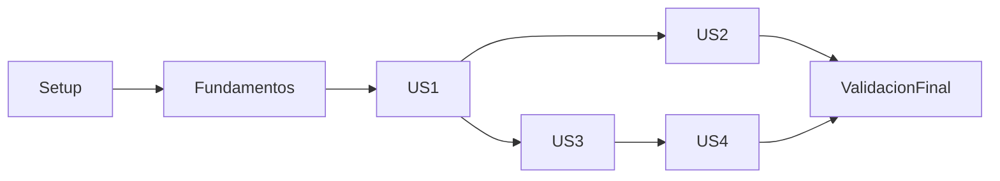

# Tasks: Video progresivo con navegación acotada

**Input**: [plan.md](plan.md), [spec.md](spec.md), [research.md](research.md), [data-model.md](data-model.md), [contracts](contracts/README.md) y [validation-plan.md](validation-plan.md).
**Branch**: `feature/009-video-progresivo`.
**Tests**: Exigidos por criterios SC y constitución; escribir pruebas antes del comportamiento nuevo y comprobar su fallo pertinente, sin probar detalles triviales.
**Organization**: Fases por historia; no modificar el código en esta etapa. Todas las tareas empiezan pendientes.

## Formato y convenciones

Cada línea contiene ID, marcador opcional [P], historia cuando corresponde y archivo concreto. [P] permite trabajo en archivos independientes una vez cumplidos sus dependencias; no autoriza ejecutar arneses que comparten puertos al mismo tiempo.

Rutas relativas al checkout principal. No crear otro worktree, cambiar la rama, sobrescribir cambios ni usar datos privados en tests. No actualizar modelo, pesos, umbrales ni límites para aparentar rendimiento. Los archivos nuevos son destinos previstos, no resultados ya disponibles.

Las restricciones de data-model.md citadas en tareas son obligatorias, junto con todas las validaciones de los esquemas. Los gates externos permanecen abiertos si falta evidencia; completar un archivo no significa aprobar su medición.

## Phase 1: Setup

**Objetivo**: Preparar referencias y pruebas aisladas sin modificar servicios activos.

- [X] T001 Congelar baseline 431b6df y corpus/condiciones en `specs/009-video-progresivo/validation-plan.md`; preparar manifiesto privado fuera de Git sin copiar secretos, registrar hashes/versiones y preservar el checkout principal.
- [X] T002 [P] Añadir únicamente av==19.0.2 a `backend/pyproject.toml` y actualizar `backend/uv.lock` con Python3.12 sin actualizar modelos ni dependencias ajenas. Dep: T001.
- [X] T003 [P] Crear fixtures deterministas CFR/VFR, B-frames, offset/edit list, rotación, vacío, denso y corto en `backend/tests/fixtures_progressive.py`, con tiempos y geometría esperados. Dep: T001.
- [X] T004 [P] Aislar stores/puertos de prueba en `backend/tests/conftest.py` y `frontend/playwright.009.config.ts`; no usar .runtime personal ni detener servicios, conservar suites existentes. Dep: T001.

**Checkpoint**: Validar los entregables antes de continuar.

## Phase 2: Foundational

**Objetivo**: Prerrequisitos compartidos. No empezar historias hasta validar esta fase.

- [X] T005 [P] Escribir pruebas de tipos/cronología en `backend/tests/unit/test_progressive_models.py`, con restricciones del modelo y serialización segura; deben fallar antes del soporte nuevo. Dep: T002–T004.
- [X] T006 [P] Escribir pruebas de migración repetida, atomicidad, vacíos y carreras de publicación en `backend/tests/integration/test_progressive_store.py`, usando base temporal. Dep: T002–T004.
- [X] T007 Implementar tipos de `backend/app/domain/models.py` y `backend/app/domain/schemas.py` según contratos: «entero de64bits» para PTS, tiempos «enteros no negativos <=2^53-1», confidence0..1 y display_bbox nullable; preservar required/enums/null de cada campo. Dep: T005.
- [X] T008 Implementar puerto/adaptador en `backend/app/adapters/timed_video_decoder.py`: BGR24, pts/time_base, «Intervalo [start_us,end_us), end>start», lookahead, último cuadro validado y mapeo de orientación; error seguro si cronología inconsistente. Dep: T007.
- [X] T009 Crear migración aditiva e índices en `backend/app/services/video_progressive_store.py` para entidades del modelo: «generación inmutable», «cuadros inmutables», unidad UUID y «unique(job_id,generation,track_id)»; conservar filas legacy sin reinicializar. Dep: T006–T008.
- [X] T010 Implementar publicación transaccional en `backend/app/services/video_progressive_store.py`: cuadros vacíos, secuencia contigua, archivos cerrados, commit de límite y revisión, duplicados idempotentes y rechazo de huecos; validar TTL/revocación en la transacción. Dep: T009.
- [X] T011 Implementar recibos de recursos en `backend/app/services/progressive_artifacts.py` con propietario, in_use y «no extensión del TTL por lectura/publicación»; purgar huérfanos sin borrar recursos ajenos. Dep: T010.
- [X] T012 Definir parámetros operativos y validación en `backend/app/core/config.py`, sin editar .env: batch15 cuadros/0,5s, margen5s y límites de páginas/colas; distinguir timeout de duración. Dep: T007.
- [X] T013 Ejecutar tests de fundamento y comparación decoder contra píxeles/PTS conocidos; registrar en `specs/009-video-progresivo/validation.md` discrepancias sin declararlas equivalentes ni cambiar modelo. Dep: T008–T012.

**Checkpoint**: Validar los entregables antes de continuar.

## Phase 3: User Story 1 — ver mientras procesa (P1)

**Objetivo**: Primer incremento útil: prefijo visible con pausa automática, acceso seguro y resultado final compatible.

**Prueba independiente**: Video controlado>=30s: primera vista<=2s desde cinco segundos confirmados; ningún cuadro fuera del prefijo; cola corta y vacío reproducibles.

- [X] T014 [P] [US1] Escribir contrato de opt-in, estado/source y modo legacy en `backend/tests/contract/test_progressive_api.py`, conforme a OpenAPI; mantener respuesta202 existente. Dep: T013.
- [X] T015 [P] [US1] Escribir prueba de arranque real con fakes en `backend/tests/integration/test_progressive_pipeline.py`: crear app, inyectar servicios, publicar antes de EOF y cerrar recursos; comprobar modelos únicos y aislamiento. Dep: T013.
- [X] T016 [P] [US1] Escribir pruebas del estado play/pausa/espera y cola terminal en `frontend/tests/features/video-analysis/playbackReducer.test.ts`; no usar temporizadores reales para simular el análisis. Dep: T013.
- [X] T017 [US1] Implementar presentation=progressive e idempotencia por modo en `backend/app/services/video_job_service.py` y ruta de creación; ausencia mantiene legacy, query repetida/desconocida422. Dep: T014.
- [X] T018 [US1] Implementar estado/snapshots y páginas en `backend/app/services/video_progressive_service.py`: «from_us>=0», «to_us>from_us», ventana<=30.000.000us, snapshot>=0, cursor<=512; límites1MiB/1.000 observaciones/100 partes sin truncar, vacío confirmado. Dep: T010,T017.
- [X] T019 [US1] Implementar fuente MP4 protegida GET/HEAD y Range en `backend/app/services/progressive_media.py`, con TTL entre bloques, no-store y referencias en uso; no limitar bytes por segundo procesado. Dep: T011,T018.
- [X] T020 [US1] Registrar API y conectar store/servicio en `backend/app/main.py` y `backend/app/core/lifespan.py`; crear rutas en `backend/app/api/routes/video_playback.py`, inyección explícita y pruebas de arranque, sin inicializaciones globales nuevas. Dep: T018,T019.
- [X] T021 [US1] Ampliar `backend/app/web/proxy.py` y `backend/app/web/main.py` con descriptor progressive-source, preflight propio y CSRF para JSON; conservar completed de medios legacy. Dep: T020.
- [X] T022 [US1] Conectar único decode y lotes al `backend/app/services/video_processing.py`, sin lista ilimitada de detecciones, con PresentationFilter persistido y sin repetir carga de modelos. Dep: T008,T010,T015.
- [X] T023 [US1] Mantener exportación final y detecciones legacy en `backend/app/services/video_job_store.py`, consumiendo observaciones persistidas y separando análisis de exportación; no reinterpretar processed-cfr/conteo. Dep: T022.
- [X] T024 [US1] Crear parser progresivo en `frontend/src/features/video-analysis/progressiveTypes.ts` y métodos de `frontend/src/services/apiClient.ts`; validar job/generation/revision, sin cambiar parser legacy. Dep: T020.
- [X] T025 [US1] Implementar `frontend/src/features/video-analysis/useProgressivePlayback.ts` y reducer: margen5s/tail terminal, polling500ms de una petición, intención separada de pausa y timer de vencimiento; no inventar disponibilidad. Dep: T016,T024.
- [X] T026 [US1] Crear `frontend/src/features/video-analysis/ProgressiveVideoPlayer.tsx`: decoder silenciado no visible, admisión de píxeles/cajas por mediaTime y controles básicos; congelar salida fuera del límite, nunca mostrar original como fallback. Dep: T025.
- [X] T027 [US1] Integrar montaje durante análisis en `frontend/src/features/video-analysis/VideoWorkspace.tsx`; progresos separados, conteo solo al completarse y cambio de modo sin perder trabajo. Dep: T021,T023,T026.
- [X] T028 [US1] Añadir E2E de primer tramo y límite visible en `frontend/e2e/video-progressive-start.spec.ts` con backend controlado y marca temporal del commit. Dep: T027.
- [X] T029 [US1] Añadir E2E de vacío, clip<5s y pausa manual frente a automática en `frontend/e2e/video-progressive-buffer.spec.ts`. Dep: T027.
- [X] T030 [US1] Medir callbacks/canvas y compatibilidad en `frontend/e2e/video-progressive-render.spec.ts`, incluyendo JS ocupado y ausencia de soporte; no aprobar con solo existencia de API. Dep: T026,T028.
- [X] T031 [US1] Verificar US1 y registrar SC001/005/006 en `specs/009-video-progresivo/validation.md`, distinguiendo pruebas controladas de gates reales pendientes. Dep: T028–T030.

**Checkpoint**: Verificar US1 con los resultados de su fase; no cerrar gates no medidos.

## Phase 4: User Story 2 — navegación acotada (P1)

**Objetivo**: Retroceder y volver al último cuadro analizado sin reinferir ni mostrar cajas antiguas.

**Prueba independiente**: Fuente120s/límite42: permitir10/30/último cuadro, bloquear60/final por todas las vías y no desplazar al crecer a55.

- [X] T032 [P] [US2] Probar ventanas y snapshots en `backend/tests/contract/test_progressive_frames.py`: «to_us>from_us», máximo30.000.000us, cursor<=512, páginas densas divididas sin truncar. Dep: T031.
- [X] T033 [P] [US2] Probar caché y seek en `frontend/tests/features/video-analysis/navigation.test.ts`, incluidos límite exclusivo y respuestas antiguas. Dep: T031.
- [X] T034 [US2] Implementar LRU y ensamblado de partes en `frontend/src/features/video-analysis/frameCache.ts`:16MiB/30s acumulados, cuatro páginas en vuelo, offset/total y vacíos; recuperar historia expulsada. Dep: T032,T033.
- [X] T035 [US2] Crear `frontend/src/features/video-analysis/VideoTimeline.tsx` con tiempos, posición/límite distinguibles sin solo color, controles táctiles y teclado. Dep: T033.
- [X] T036 [US2] Integrar seek validado en `frontend/src/features/video-analysis/useProgressivePlayback.ts`: mantener posición al crecer límite y usar last_frame_start_us al final exclusivo, sin POST nuevo. Dep: T034,T035.
- [X] T037 [US2] Implementar fullscreen de contenedor y tratamiento de acciones de media en `frontend/src/features/video-analysis/ProgressiveVideoPlayer.tsx`; impedir vías nativas expuestas y preservar salida canvas. Dep: T036.
- [X] T038 [US2] Probar barra/teclado/toque/fullscreen en `frontend/e2e/video-progressive-navigation.spec.ts`, incluida ampliación200%. Dep: T037.
- [ ] T039 [US2] Medir30 saltos, al menos29<1s y memoria acotada en `frontend/e2e/video-progressive-seek.spec.ts`, con caché expulsado y sin inferencia adicional. Dep: T034,T037.
- [X] T040 [US2] Verificar que consultas repetidas no generan trabajo de modelo en `backend/tests/integration/test_progressive_reads.py`, y que cursor ajeno o contexto distinto se rechaza. Dep: T032,T036.
- [X] T041 [US2] Registrar aceptación US2/SC002–003 en `specs/009-video-progresivo/validation.md`, sin ocultar saltos lentos ni cambios de selección. Dep: T038–T040.

**Checkpoint**: Verificar US2 con los resultados de su fase; no cerrar gates no medidos.

## Phase 5: User Story 3 — enriquecimiento progresivo (P1)

**Objetivo**: Datos tempranos por vehículo con resultado final equivalente a la selección de evidencia vigente.

**Prueba independiente**: Al menos10 tracks, unidades pendientes/parciales y placa tardía; seleccionar/actualizar sin cambiar tiempo ni identidad y sin análisis por navegar.

- [X] T042 [P] [US3] Escribir contratos de tracks/evidencia en `backend/tests/contract/test_progressive_tracks.py`, incluidos pending200 y propietario ajeno404. Dep: T031.
- [X] T043 [P] [US3] Escribir pruebas top-K y deduplicación en `backend/tests/unit/test_progressive_evidence.py`, con mejor evidencia tardía y provisional excluida del consenso final. Dep: T031.
- [X] T044 [P] [US3] Escribir pruebas de selección/revisiones en `frontend/tests/features/video-analysis/trackResults.test.tsx`. Dep: T031.
- [X] T045 [US3] Implementar unidades y revisiones en `backend/app/services/video_progressive_store.py`, con «unique(job_id,generation,track_id)» y total abierto, sin usar ordinal detection_id. Dep: T042.
- [X] T046 [US3] Capturar top-K/provisional antes de dibujar en `backend/app/services/progressive_evidence.py`, integrado al pipeline; conservar timestamps/bbox originales y límites por track. Dep: T043,T045.
- [X] T047 [US3] Implementar worker progresivo y su arranque/cierre único en `backend/app/services/progressive_enrichment.py` y `backend/app/core/lifespan.py`; reutilizar modelos/semáforos,32 referencias RAM, una unidad activa y máximoK+1; no duplicar pools. Dep: T046.
- [X] T048 [US3] Publicar ramas/resultados y agregado abierto en `backend/app/services/video_progressive_store.py`; «evaluación única por evidencia/política» y terminalización al cerrar fuente. Dep: T047.
- [X] T049 [US3] Añadir GET tracks/detail con snapshots a `backend/app/api/routes/video_playback.py`, validando identidad y revisiones; lecturas no lanzan trabajo. Dep: T048.
- [X] T050 [US3] Añadir PNG de evidencia autorizado a `backend/app/api/routes/video_playback.py`, con TTL, sin rutas privadas ni uso del plate-preview de imagen. Dep: T046,T049.
- [X] T051 [US3] Ampliar allowlist de tracks/evidencia en `backend/app/web/proxy.py`, límites de respuesta y CSRF sin excepción nativa. Dep: T050.
- [X] T052 [US3] Crear adaptador final en `backend/app/services/enrichment_job_service.py` para resultados cacheados de fuente progresiva terminada; preservar contrato y consenso legacy sin otra decodificación. Dep: T048.
- [X] T053 [US3] Implementar consulta incremental en `frontend/src/features/video-analysis/useProgressiveTracks.ts`, snapshot estable, revisión monotónica y selección persistente. Dep: T049,T051.
- [X] T054 [US3] Crear `frontend/src/features/video-analysis/ProgressiveTrackResults.tsx` con ficha/evidencia, selección pausada y alternativa accesible a caja, sin confundir tiempo representativo con actual. Dep: T044,T053.
- [X] T055 [US3] Integrar enriquecimiento automático en `frontend/src/features/video-analysis/VideoWorkspace.tsx` sin POST duplicado ni espera al final para mostrar datos. Dep: T052,T054.
- [X] T056 [US3] Probar arranque/cierre del worker, modelos únicos y ramas en `backend/tests/integration/test_progressive_enrichment.py`; verificar inyección desde la app, top-K final y liberación de recursos sin hilos ni callbacks huérfanos. Dep: T047–T052.
- [X] T057 [US3] Añadir E2E de diez identidades y actualizaciones sin mover video en `frontend/e2e/video-progressive-tracks.spec.ts`. Dep: T055.
- [X] T058 [US3] Verificar presupuesto de evaluaciones y reutilización final en `backend/tests/unit/test_enrichment_reuse.py`; navegar no repite lecturas. Dep: T056.
- [X] T059 [US3] Registrar US3/SC004 y comparación de política en `specs/009-video-progresivo/validation.md`; no dar por acreditada precisión real con mocks. Dep: T057,T058.

**Checkpoint**: Verificar US3 con los resultados de su fase; no cerrar gates no medidos.

## Phase 6: User Story 4 — interrupciones y parciales (P2)

**Objetivo**: Conservar confirmados ante fallo técnico y retirar correctamente por acción explícita, acceso o vencimiento.

**Prueba independiente**: Fallo tras un tramo, desconexión, reinicio, cancelación y TTL; prefijo válido o retirada sin resurrección.

- [X] T060 [P] [US4] Escribir fault injection de commit/archivo/revocación en `backend/tests/integration/test_progressive_lifecycle.py`. Dep: T059.
- [X] T061 [P] [US4] Escribir pruebas de reconexión y respuestas tardías en `frontend/tests/features/video-analysis/recovery.test.ts`. Dep: T059.
- [X] T062 [US4] Separar fallo técnico/exportación en `backend/app/services/video_worker.py` y store: partial_failed conserva prefijo, complete no se pierde por encoder. Dep: T060.
- [X] T063 [US4] Cambiar recuperación progresiva en `backend/app/services/video_job_store.py`: no borrar ni reencolar generación interrumpida; preservar legacy sin recurso progresivo. Dep: T062.
- [X] T064 [US4] Implementar DELETE playback idempotente y retiro de derivados en `backend/app/services/video_progressive_service.py`, incluidas carreras y tombstone propietario. Dep: T063.
- [X] T065 [US4] Ajustar cierre/cleanup en `backend/app/services/video_artifacts.py` y `backend/app/services/temporary_cleanup.py`, sin borrado global ni extensión del plazo. Dep: T064.
- [X] T066 [US4] Terminalizar cola tras fallo/cancelación en `backend/app/services/progressive_enrichment.py`; ningún pending indefinido ni resultado tardío revive evidencia. Dep: T062,T065.
- [X] T067 [US4] Implementar backoff y retirada en `frontend/src/features/video-analysis/useProgressivePlayback.ts`, pausa de modo oculto y recuperación del mismo trabajo. Dep: T061,T066.
- [X] T068 [US4] Gestionar aceptación tardía/limpieza y revocación en `frontend/src/features/video-analysis/useVideoAnalysis.ts`, diferenciando reconsulta de nuevo análisis. Dep: T067.
- [X] T069 [US4] Añadir E2E de fallo parcial, acceso y cambio de fuente en `frontend/e2e/video-progressive-recovery.spec.ts`. Dep: T068.
- [X] T070 [US4] Ejecutar carreras y vencimiento durante stream en `backend/tests/integration/test_progressive_lifecycle.py` y gateway; registrar fallos reproducibles. Dep: T064–T069.
- [X] T071 [US4] Documentar US4/SC008 en `specs/009-video-progresivo/validation.md`, incluyendo limitaciones de reinicio y distinción de tiempos. Dep: T070.

**Checkpoint**: Verificar US4 con los resultados de su fase; no cerrar gates no medidos.

## Phase 7: Polish y aceptación

**Objetivo**: Regresiones, rendimiento real y validación humana antes de cierre.

- [X] T072 Auditar rutas y logs con pruebas en `backend/tests/integration/test_progressive_security.py`: sin secretos, acceso cruzado o URLs arbitrarias. Dep: T071.
- [X] T073 Ejecutar suites de imagen/video/conteo y compilación; registrar regresiones en `specs/009-video-progresivo/validation.md`, sin retirar tests ni tocar datos personales. Dep: T072.
- [ ] T074 Crear `backend/scripts/evaluate_video_progressive.py` según protocolo congelado, con ambos brazos aislados y todos los resultados, no solo éxitos. Dep: T073.
- [ ] T075 Ejecutar tres pares AB/BA reales y comparar calidad/PTS/identidades y coste en `specs/009-video-progresivo/validation.md`; gates110% tiempo y120% RSS, sin alterar corpus ni tratar fallos como mejoras. Dep: T074.
- [ ] T076 Medir SC001–006 en navegadores y tamaños previstos con `frontend/e2e/video-progressive-render.spec.ts`; reportar esperas separadas de FPS y desfase. Dep: T073.
- [ ] T077 Realizar prueba con cinco participantes y registrar SC009 en `specs/009-video-progresivo/usability.md`; si no hay participantes, mantener pendiente y no simular evidencia. Dep: T076.
- [X] T078 Actualizar guía de arranque/limitaciones en `specs/009-video-progresivo/quickstart.md` y README, sin publicar configuración privada. Dep: T073.
- [X] T079 Consolidar matriz FR/SC y evidencia en `specs/009-video-progresivo/audit.md`, manteniendo pendientes de otras iteraciones y gates no ejecutados. Dep: T075–T078.
- [X] T080 Verificar quickstart y estado final en `specs/009-video-progresivo/validation.md`; conservar rama/cambios existentes y confirmar solo entrega pertinente, sin declarar aceptación si quedan gates. Dep: T079.

**Checkpoint**: Validar los entregables antes de continuar.

## Dependencies & Execution Order

Setup → fundamentos → US1. US2 y US3 se integran después de US1, y pueden prepararse con fixtures independientes sin editar los mismos archivos. US4 depende de recursos de US1 y unidades de US3; la aceptación final incluye todas las historias.

- T001 precede a T002–T004; fundamentos dependen de setup.
- Dentro de cada fase, las dependencias indicadas tienen prioridad sobre el orden aparente. Las pruebas se escriben antes y se ejecutan cuando exista el comportamiento.
- Paquetes del plan: B1=T005–T013/T022; B2=T017–T023 y ciclo de vida US4; B3/B4=US3; G1=T021/T051; F1/F2=US1/US2/US3; V1=verificación por historia y fase final.
- El MVP demostrable es US1 con fundamento seguro. No equivale a cierre de la iteración ni autoriza omitir recuperación, enriquecimiento o gates finales.

### Grafo de dependencias

## Oportunidades paralelas

| Fase | Trabajo independiente | Límite |
|---|---|---|
| Setup | T002,T003,T004 tras T001 | dependencias, fixtures y aislamiento en archivos distintos |
| US1 | T014,T015,T016 tras fundamento | pruebas diferentes; integrar antes de completar la fase |
| US2 | T032,T033 | contrato y estado cliente; ejecución de navegador aislada |
| US3 | T042,T043,T044 | contratos, evidencia y componentes con fixtures |
| US4 | T060,T061 | fallos de backend y recuperación de frontend |

No paralelizar cambios sobre el mismo store/reducer ni benchmark con otras cargas. Esto describe oportunidades; no exige múltiples agentes.

## Estrategia incremental

1. Fijar baseline y completar fundamentos.
2. Entregar y validar US1 en entorno de prueba.
3. Añadir navegación US2 y enriquecimiento US3, manteniendo pruebas anteriores.
4. Completar recuperación/retiro US4.
5. Ejecutar regresiones y mediciones reales, prueba humana y auditoría. Registrar bloqueos, no marcar tareas externas por suposición.
6. Confirmar incrementos coherentes con sus archivos y conservar trabajo ajeno.

### Ejemplos por historia

- US1: T014, T015 y T016 escriben pruebas en archivos distintos tras los fundamentos.
- US2: T032 y T033 separan contrato de ventanas y estado del cliente.
- US3: T042, T043 y T044 separan contratos, evidencia y selección visual.
- US4: T060 y T061 separan fallos de backend y recuperación del cliente tras US3.

La ejecución en paralelo es opcional; los cambios que comparten archivo se realizan secuencialmente.

## Integración de arranque

T020 conecta los componentes al ciclo de vida de la app; T047 añade el worker al mismo contenedor de dependencias. T015 y T056 prueban el recorrido de arranque/cierre, sin cargar modelos reales ni duplicarlos. Los IDs se conservan.

## Trazabilidad

| Requisito | Tareas |
|---|---|
| FR-001 | T017,T018,T022,T027,T028 |
| FR-002 | T007,T009,T010,T018 |
| FR-003 | T010,T032,T060 |
| FR-004 | T026,T036,T037,T038 |
| FR-005 | T034,T036,T039,T040 |
| FR-006 | T027,T035 |
| FR-007 | T025,T029 |
| FR-008 | T025,T029 |
| FR-009 | T008,T026,T030 |
| FR-010 | T022,T026,T037 |
| FR-011 | T023,T027,T052 |
| FR-012 | T046,T047,T055 |
| FR-013 | T047,T052,T058 |
| FR-014 | T054,T055,T057 |
| FR-015 | T048,T054,T056 |
| FR-016 | T027,T071,T078 |
| FR-017 | T067,T068,T069 |
| FR-018 | T062,T063,T066,T070 |
| FR-019 | T064,T065,T068 |
| FR-020 | T019,T021,T050,T051,T072 |
| FR-021 | T035,T054,T076,T077 |
| FR-022 | T001,T013,T074,T075,T076 |
| FR-023 | T023,T052,T073 |

| Criterio | Verificación |
|---|---|
| SC001 | T028,T031,T076 |
| SC002 | T038,T076 |
| SC003 | T039 |
| SC004 | T057,T059 |
| SC005 | T013,T030,T076 |
| SC006 | T030,T076 |
| SC007 | T074,T075 |
| SC008 | T069,T070,T072 |
| SC009 | T077 |
| SC010 | T039,T075 |

## Cierre de esta generación

75 tareas cerradas con evidencia funcional; 5 verificaciones permanecen pendientes. No se acredita aceptación exhaustiva.

## Cierre funcional de implementación — 2026-11-22

Se conservan todos los IDs. Las pruebas se consolidaron: API/pipeline en test_progressive_api y workers; snapshots/páginas/carreras en store/lifecycle/race; top-K y reutilización en evidence/topk; interacción en playbackReducer/progressive/recovery/trackResults y navegación/recovery E2E. Véase validation.md/audit.md. La salida final usa VideoFrame inmutable; plan.md y contracts/player.md documentan la corrección de la estrategia de decoder.

El usuario solicitó cerrar con pruebas funcionales y commit, difiriendo la comparación larga. No se marcan aprobados por ello los gates reales ni humanos.

- T039: treinta saltos ordinarios y límites de caché implementados/probados; falta medir historial expulsado y memoria prolongada.
- T074: arnés disponible con cortes de análisis, fingerprints y comparación de calidad; completar alcance RSS con gateway activo/reproductor.
- T075: comparación final detenida por el usuario; los diagnósticos de candidatos previos no son aceptación.
- T076: matriz funcional y ventanas controladas medidas; falta evaluación exhaustiva real. WebKit Windows acredita incompatibilidad segura.
- T077: prueba de cinco personas pendiente; no se simula evidencia.

## Phase 8: Convergence

**Fecha**: 2026-11-22. **Resultado**: tasks_appended. Revisión del estado presente contra spec.md, plan.md, las 80 tareas y la constitución; no se usaron comparaciones de ramas como evidencia de comportamiento. Se conservan íntegros los documentos y las tareas anteriores. No se modificó código de aplicación ni configuración privada.

**Inventario revisado**: 23 FR, 10 SC y 23 escenarios de aceptación; 9 decisiones técnicas (cronología/conversión, publicación transaccional, opt-in/compatibilidad, acceso/Range, paginación/caché, salida/controles, enriquecimiento compartido, retiro/recuperación y protocolo de validación); 5 principios constitucionales y 80 tareas. Los archivos de pruebas consolidados se valoraron por comportamiento, no por los nombres originalmente previstos.

**Clasificación**: 7 correcciones de implementación, 1 arnés de validación incompleto y 4 verificaciones pendientes. Tipos: missing=3, partial=7, contradicts=2. Severidades: CRITICAL=1, HIGH=7, MEDIUM=4. La severidad crítica de F1 deriva de un MUST constitucional de observabilidad; no equivale a una fuga de datos observada.

### Correcciones y verificaciones trazables

Ordenadas por severidad. Los IDs nuevos referencian los pendientes originales para no confundir falta de evidencia con un defecto demostrado. Completar un archivo o aprobar fixtures no cierra un gate real o humano.

- [X] T081 **CRITICAL — IMPLEMENTACIÓN — F1** Restaurar instrumentación operacional en `backend/app/services/progressive_processing.py` y su integración con `backend/app/core/logging.py`: medir latencia por cuadro, RSS/memoria, resultado y errores por trabajo, con identificadores seguros y sin medios, placas, secretos ni rutas privadas; conservar los acumulados de fases sin depender del benchmark externo. Añadir aserciones en las pruebas del pipeline para éxito, fallo y cierre. Evidencia: el recorrido progresivo omite `video_frame_processed`; el único `progressive_video_outcome` observado sobre 12 cuadros no contiene `frame_ms` ni `memory_mb`. Conforme a Constitution II/V y T022 (missing).
- [X] T082 **HIGH — IMPLEMENTACIÓN — F2** Recuperar fallos transitorios de Range/inicialización/decodificación en `frontend/src/features/video-analysis/ProgressiveVideoPlayer.tsx` y `sourceDecoder.ts`: distinguir red/timeout/5xx de incompatibilidad real, pausar conservando intención y posición autorizada, reintentar con backoff acotado y abortar por retiro/TTL/cambio de generación; no crear otro trabajo ni mostrar original/cajas antiguas. Probar fallo de lectura seguido de recuperación del mismo trabajo. Evidencia: un error de red de inicialización produce una sola inicialización, aviso de incompatibilidad y Reproducir deshabilitado aun después de nuevas revisiones de estado. Conforme a FR-007/017, US4/AC1 y T067 (contradicts).
- [X] T083 **HIGH — IMPLEMENTACIÓN — F3** Añadir recuperación acotada de consultas de fichas y recortes en `frontend/src/features/video-analysis/useProgressiveTracks.ts` y `ProgressiveTrackResults.tsx`, sin depender de que cambie `enrichment.revision`; mantener resultados válidos y selección, distinguir carga de fallo recuperable y cancelar reintentos/respuestas tardías al retirar la fuente. Probar una consulta fallida y recuperación con la misma revisión, incluidos resultados finales. Evidencia: la comprobación del hook obtiene una petición y cero fichas tras recuperar red y recibir estados nuevos con revisión de enriquecimiento constante; los efectos de recortes tampoco programan recuperación. Conforme a FR-015/017/019, US3/AC3 y US4/AC1 (partial).
- [X] T084 **HIGH — IMPLEMENTACIÓN — F4** Representar explícitamente los estados reales de unidad, atributos y placa en `frontend/src/features/video-analysis/ProgressiveTrackResults.tsx`: pendiente, disponible, parcial, no aplicable, fallido y retiro por vencimiento conforme al contrato, conservando datos válidos y diferenciando provisional/final de éxito/fallo. Añadir pruebas de cada estado y transiciones. Evidencia: unidades finales `failed` y `not_applicable` producen HTML idéntico («Resultado final», «Datos finales», «Placa No disponible»); `track.state` y `attributes.status` no gobiernan las etiquetas actuales. Conforme a FR-015, US3/AC4 y T054 (partial).
- [ ] T085 **HIGH — IMPLEMENTACIÓN — F5** Completar en `frontend/src/features/video-analysis/VideoProgress.tsx`, `VideoTimeline.tsx` y los contratos/estado necesarios la distinción visible entre duración del archivo (estimada/confirmada), tiempo de procesamiento transcurrido, plazo operativo de procesamiento y tramo reproducible. Obtener tiempos y límites de fuentes autorizadas; no tratar el máximo de duración de carga como timeout ni inventar una finalización garantizada. Probar procesamiento, cola, resultado parcial y final, y documentar cualquier campo aditivo necesario sin alterar contratos legacy. Evidencia: los componentes actuales muestran cuadros/porcentaje, duración y cobertura; no muestran tiempo de procesamiento ni su plazo permitido. Conforme a FR-016, US4/AC6 y T027/T071 (partial).
- [ ] T086 **HIGH — VALIDACIÓN PENDIENTE — F8** Completar T039 con pruebas reproducibles en `frontend/e2e/video-progressive-navigation.spec.ts` o archivo de seek dedicado: al menos 30 saltos incluyendo historial realmente expulsado, al menos 29 con imagen/cajas correctas en menos de 1 s, sin inferencia adicional y con presupuestos de memoria comprobados durante navegación repetida. Registrar resultados y fallos en `specs/009-video-progresivo/validation.md`; los saltos actuales Home/End dentro del prefijo corto no acreditan expulsión de historia. No se afirma un defecto de caché por faltar esta medición. Conforme a SC-003/010 y T039 (partial).
- [ ] T087 **HIGH — VALIDACIÓN PENDIENTE — F9** Completar T076 y la matriz SC001–006 en los E2E progresivos y `specs/009-video-progresivo/validation.md`: escenario120s/límite42s, identidades y latencia publicación→ficha, cronologías admitidas, resize/fullscreen y varias ventanas de FPS con espera contabilizada aparte, en tamaños/navegadores previstos; indicar incompatibilidades reales sin contarlas como reproducción aprobada. Usar fixtures y evidencia explícita, sin ejecutar la comparación larga diferida de T088. No se infiere incumplimiento medido de FPS a partir de una prueba ausente. Conforme a SC-001/002/004/005/006 y T076 (partial).
- [ ] T088 **HIGH — VALIDACIÓN DIFERIDA, NO EJECUTAR SIN NUEVA AUTORIZACIÓN EXPRESA — F10** Completar T075 únicamente cuando el usuario reautorice la comparación larga: tres pares reales AB/BA sobre el candidato final tras T090, corpus/equipo/configuración congelados, todos los fallos y métricas de calidad, tiempo por fase/conjunto y memoria documentados en `specs/009-video-progresivo/validation.md`. Mantener gates110%/120%, sin tratar paridad de píxeles ni diagnósticos previos como aceptación de coste. La convergencia actual no ejecuta ni reautoriza estas mediciones. Conforme a FR-022, SC-007/010 y T075 (missing).
- [X] T089 **MEDIUM — IMPLEMENTACIÓN — F6** Mantener finalización natural estable en `frontend/src/features/video-analysis/ProgressiveVideoPlayer.tsx` y `playbackPolicy.ts`: al agotar una fuente terminal detener reloj/intención automática y conservar el último cuadro; reanudar solo mediante una acción explícita o navegación válida, sin confundirlo con espera de análisis. Añadir prueba del componente real con clip corto y final completo/parcial. Evidencia: tras alcanzar el final el tick vuelve a `last_frame_start_us` y la decisión terminal `margin>0` reinicia el reloj; un clip terminal de un cuadro sigue indicando «Reproduciendo a velocidad original · 1×» después de su duración. La prueba aislada de `ended=true` no verifica esa integración. Conforme a FR-007/009, plan: reloj/cola terminal y T025/T029 (contradicts).
- [ ] T090 **MEDIUM — ARNÉS DE VALIDACIÓN INCOMPLETO — F7** Completar T074 en `backend/scripts/evaluate_video_progressive.py` y el soporte de medición necesario: RSS simultánea del árbol API/workers/encoder y gateway activo, memoria del reproductor aparte, alcance idéntico en ambos brazos, cortes de reloj y resultados de enriquecimiento explícitos, comparación de calidad prevista y procedencia del candidato/corpus/configuración de cada resultado reutilizado. Verificar el arnés con fakes/ensayos breves; no ejecutar por ello T088. Evidencia: `rss_scope` excluye gateway activo/reproductor y la aceptación exhaustiva del protocolo sigue pendiente. Conforme a plan: V1/protocolo de validación, FR-022, SC-007/010 y T074 (partial).
- [ ] T091 **MEDIUM — VALIDACIÓN EXTERNA PENDIENTE — F11** Completar T077 cuando haya cinco participantes reales autorizados, registrando en `specs/009-video-progresivo/usability.md` pantalla, teclado/texto200%, comprensión del límite, retroceso/regreso e inspección, y el resultado mínimo4/5. Mantener pendiente si faltan participantes; no simular personas ni sustituirlas por tests o capturas. No requiere otra implementación por el solo hecho de faltar participantes. Conforme a SC-009 y T077 (missing).
- [X] T092 **MEDIUM — IMPLEMENTACIÓN/ARRANQUE — F12** Corregir la selección/fallback de Python en `backend/start.ps1` para que un entorno `backend/.venv` inválido o sin dependencias no interrumpa el script con `NativeCommandError` bajo Windows PowerShell y `$ErrorActionPreference='Stop'`; continuar con el entorno compatible de la raíz y, si ninguno sirve, devolver un diagnóstico claro. Añadir verificación de primer candidato inválido/segundo válido y ambos inválidos, sin arrancar ni detener servicios personales. Evidencia: error aportado por el usuario en la línea16 al ejecutar `-Service gateway`; la comprobación nativa aborta antes del fallback. Conforme a FR-023, plan: conservar Python/entorno compatible y T078/T080 (partial).

### Evidencia de esta convergencia y límites

- Pruebas existentes ejecutadas: 29 backend progresivas aprobadas (291 deseleccionadas), 15 frontend de video aprobadas en 7 archivos. Estos resultados no cubren los defectos nuevos ni sustituyen las suites completas de la entrega anterior.
- Comprobaciones adicionales en memoria, sin editar aplicación: fallo de consulta con revisión constante (1 petición/0 fichas), HTML idéntico de failed/not_applicable, inicialización de fuente fallida sin reintento (1 inicialización y botón deshabilitado), final terminal que sigue indicando reproducción y captura de llamadas de logs del pipeline de12cuadros sin latencia por cuadro/RSS. Se requieren regresiones permanentes al implementar las correcciones.
- Incidencia de ejecución separada de los defectos: el gateway activo anterior rechazaba `presentation=progressive` con422 `web_query_invalid`, mientras la ruta legacy devolvía401 sin sesión. El proceso seguía cargado sin recarga automática desde antes de esta implementación. Se cerraron los procesos de los puertos5173/4174/8000 a petición del usuario y se comprobó que quedaron libres; no se cerraron servicios de otros puertos. Reiniciar el gateway actualizado y renovar la sesión es necesario para volver a probar. No se atribuye ese rechazo a un timeout300s ni a calidad del modelo.
- `npm --prefix frontend run dev` corresponde a la raíz; dentro de frontend se usa `npm run dev`. Si el arranque mediante script falla por F12, los comandos directos con el entorno compatible desde backend permiten ver los logs sin ese selector.
- No se ejecutó la comparación larga, no se cambió modelo/muestreo/límites/retención y no se cerró ningún gate por falta de evidencia. T039/T074–T077 siguen como estaban; T086–T088/T090–T091 detallan su trabajo restante sin duplicar mediciones ya válidas.
- Sin hooks before_converge/after_converge registrados en `.specify/extensions.yml` (YAML leído correctamente). Resultado `tasks_appended`; no se declara convergencia completa.

## Phase 9: Inspección bajo demanda y conteo opcional — cambio aprobado 2026-11-22

La instrucción del usuario sustituye el enriquecimiento automático del nuevo frontend por consulta al seleccionar, con ficha igual a Imagen y conteo opcional sincronizado. Conservar clientes legacy/auto, rama y datos existentes. No ejecutar T088 ni pruebas humanas pendientes.

- [X] T093 Añadir opt-in on-demand persistente y solicitud idempotente por Track ID con evidencia congelada; sin inferencia por GET ni para vehículos no solicitados; respetar propietario/TTL y resultados cacheados. Backend/API/gateway y regresiones.
- [X] T094 Añadir conteo progresivo opcional por línea normalizada, con trayectorias existentes, revisiones, instante source-PTS y un cruce por Track ID; retroceder consulta acumulados históricos sin sumar otra vez. Mantener conteo legacy.
- [X] T095 Rehacer ficha lateral de video usando jerarquía de Imagen, recortes legibles y estados reales; sacar la lista de encima de la ficha y mostrar acceso compacto a vehículos del fotograma. Selección pausa y solicita solo ese vehículo.
- [X] T096 Reemplazar barra global de enriquecimiento por editor inferior de línea sobre fotograma confirmado, accesible por toque/teclado, activación/desactivación y contador arriba a la derecha del video principal, sincronizado al navegar.
- [X] T097 Completar regresiones relacionadas: recuperación de fichas/recortes, final natural, métricas del pipeline y selector de entorno de start.ps1, sin modificar límites/modelos/configuración privada.
- [X] T098 Ejecutar pruebas backend/frontend/build y navegador aislado para inspección, conteo, retroceso y responsive; documentar resultados efectivos sin declarar gates reales pendientes aprobados.
- [X] T099 Actualizar spec/plan/contratos/guía con el cambio de política aprobado, confirmar solo archivos pertinentes y cerrar métricas de esta entrega.

### Cierre del cambio aprobado: detección primero — 2026-11-22

T093–T099 entregan la política selectiva, ficha y conteo. Se cierran además T081–T084/T089/T092 con sus regresiones relacionadas; T085–T088/T090–T091 y los gates originales aún abiertos no se declaran completados. La comparación larga y la prueba humana no se ejecutan. La disponibilidad de los cambios exige reiniciar API y gateway; el frontend de desarrollo recarga sus recursos. Véase validation.md para resultados y límites.
