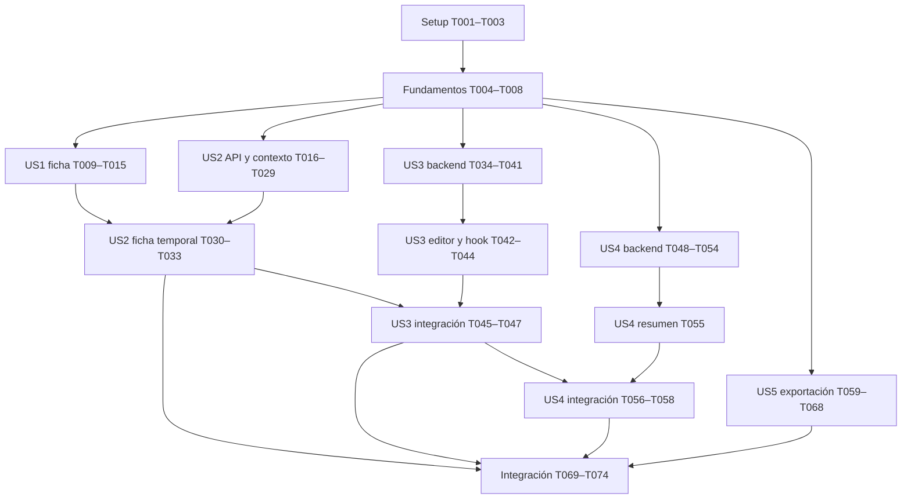

# Tasks: Inspección temporal, cruces dirigidos y resumen por clase

**Input**: `specs/010-video-detalle-conteo/` — spec, plan, research, data-model, contracts y quickstart.

**Branch**: `feature/010-video-detalle-conteo` | **Date**: 2026-11-24 | **Estado**: tareas generadas, implementación no iniciada.

**Tests**: Se incluyen por los escenarios y SC-001–SC-009 de la especificación, el plan aprobado y el principio IV de la constitución. Escribir primero las regresiones pertinentes, observar la carencia inicial y ejecutar las verificaciones tras implementar; ninguna prueba de producto se ejecuta al generar este documento.

**Organization**: Setup → fundamentos bloqueantes → US1/US2/US3/US4 (P1) → US5 (P2) → integración y cierre. B1–B5 del plan se reparten por la historia que sirven, no en una fase de backend separada sin valor comprobable.

## Format: `[ID] [P?] [Story] Description`

- Todas las tareas empiezan `- [ ] Tnnn`; `[USn]` solo en fases de historia. `[P]` indica trabajo sin conflicto de archivos después de completar sus dependencias; no autoriza saltarlas ni lanzar tareas que editan el mismo archivo a la vez.
- Las rutas son relativas al checkout principal `C:/Users/USER/Desktop/Mateo/GESTIÓN DE PROYECTOS`; los archivos nuevos son destinos futuros, no implementados.
- Cuerpos, enums, longitudes y nullabilidad restantes se toman literalmente de `contracts/schemas.json`; las restricciones del modelo de datos se citan en las tareas responsables para no dejarlas a discreción de implementación.
- Preservar branch, archivos, modos de detección, configuración privada y separación frontend/backend. No crear worktree, mover Speckit, instalar GPU ni iniciar comparación larga.
- Los campos del contrato con límites comunes usan enteros seguros, UUID y formato cerrado de T005; cada tarea de DTO específico hereda esas reglas y sus requisitos de esquema. No cambiar un contrato aprobado para acomodar un test sin registrar la decisión.

## Phase 1: Setup — entorno y validación aislados

**Goal**: Preparar fixtures y herramientas sin iniciar trabajos privados ni cambiar modelos/configuración del usuario.

**Independent Test / Checkpoint**: Los servidores/fixtures usan rutas temporales y puertos propios; no hay cambios en pesos, backend .env privado ni trabajos existentes.

- [X] T001 Crear el harness sintético autocontenido `backend/tests/performance/test_video_detail_overhead.py` y capturar la referencia previa en `specs/010-video-detalle-conteo/evidence/publication-baseline.json` ANTES de cualquier cambio de backend/app o frontend/src: sin depender de T002/APIs010, una ejecución de calentamiento y al menos3 medidas, mediana de análisis/publicación, entorno/paquetes, fixture/parámetros y huella fuente. Modo de captura explícito, escritura única sin sobrescritura; no ejecutar comparación larga ni modelos reales. Registrar comandos/estado de base en `specs/010-video-detalle-conteo/validation.md`; mantener rama/cambios privados y detector/hilos/intervalo. [FR 022,024; SC 008]

- [X] T002 Preparar fixtures sintéticos reutilizables en `backend/tests/fixtures_010.py` y `frontend/tests/fixtures/videoDetail010.ts`: misma identidad en 3 s/20 s, PTS no cero/VFR/rotación, clases/empates/persona/desconocidos, trayectorias y cajas de bordes; sin medios privados ni modelos reales. Depende de T001.

- [X] T003 Configurar entorno Playwright010 aislado en `frontend/playwright.010.config.ts` y `backend/tests/e2e/serve_video_detail_010.py`, reutilizando patrones009 y directorios temporales; incluir una imagen y un video y registrar cleanup de servicios propios. Depende de T002.

## Phase 2: Foundational — contratos y acceso compartidos

**Goal**: Completar bases de contrato, protección del padre y capacidades antes de cualquiera de las historias.

**Independent Test / Checkpoint**: Contratos cerrados y guards rechazan entradas inválidas/propietario ajeno, sin crear inspecciones, votos, cruces o exportaciones por GET.

- [X] T004 Añadir primero regresiones de contratos/primitivas y capacidad conservadora en `backend/tests/contract/test_video_detail_foundation.py`, basadas en `specs/010-video-detalle-conteo/contracts/schemas.json`; cubrir UUID, enteros seguros, bool rechazado, no finitos, cuerpos/query desconocidos/duplicados y capacidades sin efectos. Depende de T003.

- [X] T005 Implementar primitivas y Capabilities en `backend/app/domain/video_detail.py`: «job/generation como pertenencia», enteros «0..2^53-1» y «track>=1», UUID, fechas y errores seguros; aplicar esquemas cerrados/no finitos y protocolo `video-detail-v1` de `contracts/schemas.json`, sin alterar PlaybackState/FrameSlice legacy. Crear también taxonomía pura compartida en `backend/app/domain/vehicle_taxonomy.py`, con normalización y conjunto de clases vehiculares conocidas independiente de VEHICLE_CLASSES; será reutilizada por conteo e inventario sin depender de implementar US3. Depende de T004. [FR 022,023]

- [X] T006 Implementar guard y lease reutilizables en `backend/app/services/video_detail_access.py`, extendiendo `backend/app/services/video_progressive_store.py` solo para puntos de integración aditivos: «Parent check antes de reclamar, inferir y publicar», propiedad/generación/TTL, reader lease y limpieza registrable sin BEGIN anidado ni cambios en tablas legacy. Depende de T005. [FR 022,023]

- [X] T007 Implementar GET /playback/capabilities en `backend/app/api/routes/video_detection_summary.py` y su servicio `backend/app/services/video_detail_capabilities.py`; «Capacidades independientes» según fuente+PTS, mediciones e inventario verificables; no anunciar como supported un servicio/dato inexistente ni disparar reconstrucción desde GET. Depende de T006. [FR 018,022,023]

- [X] T008 Conectar capabilities y allowlist exacta en `backend/app/main.py` y `backend/app/web/proxy.py`; preservar sesión/CSRF/API key, errores 404/410, respuestas no-store y contratos cerrados previos. Ejecutar T004 y registrar en `specs/010-video-detalle-conteo/validation.md` sin incluir secretos. Depende de T007. [FR 022,023,024]

## Phase 3: User Story 1 — ficha consistente con imágenes (P1, MVP visual)

**Goal**: Compartir estructura visual con imágenes y eliminar el scroll vertical de toda la ficha de video.

**Independent Test / Checkpoint**: Comparar fichas con todos los apartados a360/768/1440: scroll normal de página, cierre/foco y zoom local de placa, sin horizontal ni pérdida del flujo de imágenes.

- [X] T009 [P] [US1] Escribir regresiones de shell/estados y adaptación de ficha en `frontend/tests/features/video-analysis/videoDetailsLayout.test.tsx`; comprobar orden, confianza, cierre, clases de tamaño y que el zoom de placa conserve sus controles, usando datos fijos sin depender de US2. Depende de T008. [FR 001,002,003; SC 001,009]

- [X] T010 [P] [US1] Escribir recorrido visual/teclado/toque a360/768/1440 en `frontend/e2e/video-detail-layout.010.spec.ts`; verificar ficha completa sin altura/scroll propios ni desbordamiento de página, comparar imagen y video y guardar capturas de evidencia sintética. Depende de T008. [FR 001,002,003; SC 001,009]

- [X] T011 [US1] Extraer presentación compartida a `frontend/src/components/vehicle-details/VehicleDetailsCard.tsx` y `frontend/src/components/vehicle-details/vehicleDetails.css`: encabezado, cierre, recorte, atributos y placa; adaptadores por origen, sin llamadas API ni identidades inventadas dentro del shell. Depende de T009, T010. [FR 001,002,003]

- [X] T012 [US1] Adaptar `frontend/src/features/image-analysis/VehicleDetails.tsx` al shell conservando estados, confianza, preview y acceso actuales de imágenes; ejecutar sus regresiones sin cambiar contratos ni comportamiento del análisis de imagen. Depende de T011. [FR 001,003,022]

- [X] T013 [US1] Adaptar `frontend/src/features/video-analysis/ProgressiveTrackResults.tsx` a la misma presentación con Track ID y tiempo propios, preservando el adaptador legacy mientras US2 no esté conectado y sin insertar una lista completa encima de la ficha. Depende de T012. [FR 001,002,003]

- [X] T014 [US1] Eliminar únicamente max-height/overflow de toda .progressive-details y unificar ancho/tokens/breakpoints con imágenes en `frontend/src/styles.css`; conservar scroll de visores ampliados, foco, botones tocables y página sin horizontal. Depende de T013. [FR 001,002,003; SC 001,009]

- [X] T015 [US1] Ejecutar T009–T010 y regresiones de imagen/video de la ficha; revisar capturas y registrar evidencia de US1 en `specs/010-video-detalle-conteo/validation.md` y `specs/010-video-detalle-conteo/evidence/ui-layout.json`. Este checkpoint entrega el MVP visual sin afirmar resuelta todavía la evidencia temporal. Depende de T014. [FR 001,002,003,024; SC 001,009]

## Phase 4: User Story 2 — inspección temporal estable (P1; B1 y parte de B5)

**Goal**: Congelar evidencia del fotograma realmente seleccionado y enriquecer solo ese contexto, con dedup, cuotas y ciclo de vida.

**Independent Test / Checkpoint**: Mismo Track ID en3s/20s obtiene contextos correctos; reabrir20s no repite trabajo; 30s de polling no cambian asset/zoom; respuestas tardías, vencimiento y fallos nunca mezclan evidencia ni retiran un padre vigente.

- [X] T016 [P] [US2] Escribir contratos de POST/GET inspección, PNG y preview en `backend/tests/contract/test_video_inspections.py`: cuerpos/query cerrados, igualdad de clave, frame confirmado/presente, generación, local404/410 vs padre410, metadata de video sin IDs de imagen y estados/nullabilidad de los esquemas. Depende de T008. [FR 004,005,006,007,008,023; SC 002,003]

- [X] T017 [P] [US2] Escribir pruebas de extracción/cola/TTL/reinicio en `backend/tests/unit/test_selected_frame_extractor.py` y `backend/tests/integration/test_video_inspections.py`: VFR/rotación/PTS, caja predicha, POST perdido, cuota, decode bloqueado, worker interrumpido, retirada durante modelo y ausencia de fallback temporal/Yolo de escena. Depende de T008, T002. [FR 004,005,006,007,008,023; SC 002,003,008]

- [X] T018 [P] [US2] Escribir regresiones del hook/recursos en `frontend/tests/features/video-analysis/videoInspection.test.tsx` y `frontend/tests/features/video-analysis/videoInspectionAssets.test.tsx`: 3s→20s, POST perdido, selección/seek/cierre rápidos, resultados invertidos,30s de revisiones, blob/zoom estable y410 local sin retirar video. Crear también antes de implementar `frontend/e2e/video-inspection.010.spec.ts`, incluida una imagen de regresión y los mismos casos temporales/metadata. Depende de T008, T002. [FR 004,005,006,007,008; SC 002,003]

- [X] T019 [US2] Definir DTOs Inspection y Assets en `backend/app/domain/video_inspection.py`, según `$defs/Inspection`/`Attributes`/`Plate` y Base de T005; copiar restricciones literales del modelo: inspection_id: «UUID opaco, clave primaria»; job, generation, owner: «Padre autorizado; owner no se devuelve»; track_id, frame_index, policy_version: «Positivos/índice>=0, única clave `(job,generation,track_id,frame_index,policy_version)`»; source_pts, time_base_num/den, start_us/end_us: «Se resuelven del recibo/timeline servidor, no del cliente; PTS racional exacto»; raw_bbox, class_name, observation_kind, confidence/confidence_kind: «Geometría validada del recibo; measured/predicted explícito. Confianza persistida, measured para medición o last_measured para caja predicha; nunca una confianza nueva inventada»; state: «queued, preparing, processing, ready, partial, unavailable, failed, not_applicable»; result_revision: «Monótono, cambia datos de esa inspección sin cambiar evidencia»; vehicle_asset_id, plate_asset_id, paths: «IDs y rutas privadas inmutables una vez publicados; cada plate deriva del crop de esa inspección»; attributes, plate, error_code: «Resultados independientes y seguros con provenance ligada al inspection_id»; expires_at, bytes_reserved/actual, claimed: «TTL<=min(padre,TTL enriquecimiento), contabilidad de cuotas, propiedad del worker». Los estados y nullabilidad deben coincidir con `contracts/schemas.json`. Depende de T016, T017, T018, T005. [FR 004,005,006,007,008,023]

- [X] T020 [US2] Añadir límites positivos en `backend/app/core/config.py` y `backend/.env.example`: VIDEO_INSPECTION_MAX_QUEUED=20, MAX_CONTEXTS_PER_JOB=128, MAX_BYTES_PER_JOB=134217728, MAX_RESOURCE_BYTES=8388608, DECODE_MAX_FRAMES=300 y DECODE_TIMEOUT_SECONDS=5, todos con prefijo VIDEO_INSPECTION_; validar «recurso<=cuota de job» y «Plazo del subproceso incluido arranque; positivo», sin editar .env privado. Depende de T019. [FR 008,023]

- [X] T021 [US2] Implementar almacenamiento aditivo y admisión en `backend/app/services/video_inspection_store.py`: clave única `(job,generation,track_id,frame_index,policy_version)`, `selected-frame-v1`, reservas por transacción y dedup antes de cuota; «TTL<=min(padre,TTL enriquecimiento)» fijo desde primer POST. Tombstones sin media/atributos/placas/bbox hasta TTL padre cuentan entre128 admisiones; mismo contexto vencido devuelve410 sin recrearlo; bytes se liberan al retirar assets. Depende de T019, T020, T006. [FR 004,006,007,008,023]

- [X] T022 [US2] Compartir conversión aprobada ITU601/BICUBIC/rotación de `backend/app/adapters/timed_video_decoder.py` y resolver/persistir base temporal privada cuando haga falta; implementar extracción exacta en `backend/app/adapters/selected_frame_extractor.py`, por PTS racional tras keyframe, bbox servidor y300 cuadros máximo. No convertir FPS, aceptar píxeles/bbox/URL del cliente ni cambiar FrameSlice público. Depende de T021, T017. [FR 004,005,022]

- [X] T023 [US2] Implementar hijo PyAV-only y watchdog en `backend/app/adapters/selected_frame_worker.py` y `backend/app/adapters/selected_frame_extractor.py`: «Watchdog de5s desde el arranque, límite300 cuadros y8MiB de salida; timeout/retirada implica terminate/join y limpieza»; sin app.main/Torch/modelos/shell/ventana, lease padre hasta completar. Verificar PTS/geometría/bytes y vigencia antes de rename/publicación; nunca fallback a aparición antigua. Depende de T022. [FR 004,005,008,023]

- [X] T024 [US2] Implementar servicio/worker acotado en `backend/app/services/video_inspections.py`: un worker, POST rápido deduplicado, estados «queued, preparing, processing, ready, partial, unavailable, failed, not_applicable», crop publicado inmutable y procesador existente con progressive_slots solo durante modelos. «Processing interrumpido termina failed/inspection_interrupted, no se repite OCR automáticamente»; preparing recuperable reutiliza hash/crop verificados. Fallos terminales no se reencolan por GET. Depende de T021, T023. [FR 004,005,006,007,008,023]

- [X] T025 [US2] Implementar InspectionPlatePreviewMetadata y transformación/caché acotada en `backend/app/domain/video_inspection.py` y `backend/app/services/video_inspection_preview.py`: «coordinate_space=plate-crop», «source_to_processed de6 números finitos», «display_only=true», contexto/asset/original/procesada/perfil/TTL del esquema; reutilizar display_contrast sin OCR ni DTO/parser de imágenes fabricados. Derivados cuentan para cuota y perfil desconocido se rechaza. Depende de T024. [FR 001,006,008,023]

- [X] T026 [US2] Exponer POST /playback/inspections, GET de contexto/assets/plate-preview en `backend/app/api/routes/video_inspections.py` y registrar router en `backend/app/main.py`; resolver frame/identidad desde servidor, restringir prefijo, emitir202/404/409/410/422/429 conforme al contrato y URLs/ETag de asset estables, sin ejecutar modelos por GET de estado. Depende de T024, T025. [FR 004,005,006,007,008,023]

- [X] T027 [US2] Añadir allowlist/query exactas, metadata/medios y distinción de errores locales en `backend/app/web/proxy.py`; conectar worker, métricas separadas, cleanup de contextos/assets/tombstones y cierre de hijos/leases en `backend/app/core/lifespan.py` y `backend/app/services/video_progressive_store.py`. No ampliar TTL ni incluir perfiles de inspección en report_video_profile --latest. Depende de T026. [FR 008,022,023,024]

- [X] T028 [US2] Implementar validadores y hook `frontend/src/features/video-analysis/useVideoInspection.ts` y `frontend/src/features/video-analysis/inspectionContracts.ts`: clave job/generation/track/frame y selection_token; POST una vez con recuperación de respuesta perdida, GET progresivo, abort/filtrado de respuesta tardía y manejo local404/410. No reutilizar cache negativa de otro frame ni usar revisión global como key. Depende de T026, T018. [FR 004,005,006,007,008; SC 002,003]

- [X] T029 [US2] Crear `frontend/src/features/video-analysis/InspectionEvidence.tsx` con blob/zoom por inspection_id/asset_id, original PNG inmutable y preview de video con parser propio; «blob de navegador se cachea por inspection_id/asset_id hasta cambio de contexto/TTL, siempre en memoria». No vaciar imagen válida durante actualización del mismo asset; revocar al cambiar contexto, retirar/vencer o desmontar. Depende de T028, T025, T018. [FR 001,004,005,006,007,008]

- [X] T030 [US2] Adaptar `frontend/src/features/video-analysis/ProgressiveVideoPlayer.tsx` para pausar y capturar el frame realmente pintado con track/generation; seek/reanudar/cerrar invalidan token y ficha, no una pausa manual. Seleccionar la misma identidad en otro instante usa otro contexto; no llamar enrich legacy desde la selección010 ni elegir evidence[0] como fallback. Depende de T028, T029, T015. [FR 004,005,006,007,008,022]

- [X] T031 [US2] Conectar shell y fuentes temporales en `frontend/src/features/video-analysis/VideoInspectionDetails.tsx` y `frontend/src/features/video-analysis/ProgressiveTrackResults.tsx`: atributos/placa del mismo contexto, ausencia/fallo/vencimiento claros, confianza medida o «Confianza de la última medición» y nota «Recuadro estimado» para predicted. Preservar vistas original/procesada y ampliación sin resets por result_revision. Depende de T030, T029, T015. [FR 001,003,004,005,006,007,008; SC 002,003,009]

- [X] T032 [US2] Ejecutar el e2e de inspección temporal y la imagen de regresión escritos en T018 en `frontend/e2e/video-inspection.010.spec.ts`; verificar3s/20s,30s de estabilidad, cierre/seek, origen predicted y metadata/preview de video, sin exponer claves ni mezclar DTO de imagen. Depende de T027, T031. [FR 001,003,004,005,006,007,008,023; SC 002,003,009]

- [X] T033 [US2] Completar pruebas T016–T018 y casos de interrupción/limpieza de T023–T027; registrar resultados y límites de B1/US2 en `specs/010-video-detalle-conteo/validation.md` y `specs/010-video-detalle-conteo/evidence/inspection-validation.json`, incluyendo cero YOLO de escena al inspeccionar y sin loops de reintento de errores terminales. Depende de T032. [FR 004,005,006,007,008,022,023,024; SC 002,003,008]

## Phase 5: User Story 3 — cruces dirigidos e históricos (P1; B2 y parte de B5)

**Goal**: Editar antes del análisis, elegir flecha y contar una vez por identidad solo cruces medidos del segmento finito en ese sentido.

**Independent Test / Checkpoint**: Escena de referencia con dos cruces válidos, inverso, contacto/retorno, prolongación y predicción desmentida; dos recorridos/cinco saltos recuperan el mismo acumulado por posición y revisión, sin nuevo detector.

- [X] T034 [P] [US3] Escribir geometría pura de centros/segmento en `backend/tests/unit/test_directed_counting.py`: sentido único, extremos inclusivos, cero numérico, secuencias sobre línea/retirada/nacimiento, ida inversa o por prolongación seguida de cruce válido, predicción ignorada y varios eventos simultáneos. Añadir cruce de persona/desconocida que no suma, bicicleta/moto que sí suman y clase cambiada después que no altera un evento confirmado; un cruce no elegible no consume un futuro cruce vehicular válido. Depende de T008, T002. [FR 009,010,011,012,013; SC 004]

- [X] T035 [P] [US3] Escribir contratos/reducer de GET/PUT/DELETE en `backend/tests/contract/test_directed_count.py` y `backend/tests/integration/test_directed_count.py`: expected_revision, lost response, reinicio/dedup, cobertura semiabierta exactamente al siguiente start_us, GET sin efectos ni inferencia y padre/generación/TTL. Verificar class_key_at_crossing congelada y total histórico estable ante votos posteriores de clase u OCR. Depende de T008, T002. [FR 010,011,012,014,015,023; SC 004,005,008]

- [X] T036 [P] [US3] Escribir pruebas de borrador/flecha/arrastre y contador asincrónico en `frontend/tests/features/video-analysis/directedCount.test.tsx` y `frontend/tests/features/video-analysis/countDraft.test.tsx`: primer frame antes de POST,16:9/rotación, toque/teclado, varios cruces, seek/respuestas viejas y conservación de un valor claramente histórico mientras actualiza. Crear también antes de implementar `frontend/e2e/video-directed-count.010.spec.ts` para los recorridos/cobertura y sentidos de SC-004–SC-005. Depende de T008, T002. [FR 003,009,013,014,015; SC 005,009]

- [X] T037 [US3] Definir DTOs y tablas aditivas en `backend/app/domain/directed_count.py` y `backend/app/services/directed_count_store.py`: «Una fila por job con generation y revision monótona, incluso disabled», «puntos normalizados finitos0..1 distintos», «negative_to_positive|positive_to_negative», «finite-center-v1» y estado interno «disabled|building|ready|unavailable». Índice de eventos «(job,revision,time_us)» y clave única «(job,revision,track_id)»; no modificar p_count legacy. El evento guarda «class_key_at_crossing (clase medida vehicular elegible, normalizada e inmutable)». Depende de T034, T035, T036, T005. [FR 009,010,011,012,014,015,023]

- [X] T038 [US3] Implementar geometría/estado de trayectoria en `backend/app/services/directed_counting.py`: «Distancia cero numérica=1e-6 píxeles», último centro medido/PTS/índice, lado no nulo y contacto finito pendiente; ignorar predicted, incluir extremos, tocar/volver no suma, nacimiento sin origen no cuenta. Fecha «time_us=start_us de la medición confirmatoria», un evento por track/revisión y elegibilidad conservada tras cruce excluido. La elegibilidad de cruce se evalúa únicamente con la clase medida en la observación que confirma el paso, normalizada con strip/lower. Se admiten car, truck, bus, van, pickup, suv, sedan, hatchback, mpv, estate, bicycle y motorcycle; person, vacío y clases no catalogadas no suman cruces. Todas las mediciones conservan el estado geométrico de la trayectoria; un paso excluido por clase no consume la elegibilidad para un futuro cruce válido. Guardar class_key_at_crossing inmutable en el evento y no reevaluarlo con votos futuros, clasificación consolidada u OCR. Esta política no restringe el resumen: sus clases no catalogadas siguen visibles con requires_review. Reutilizar `backend/app/domain/vehicle_taxonomy.py` de T005. Depende de T037, T034. [FR 010,011,012,013,014; SC 004]

- [X] T039 [US3] Implementar configuración CAS/reducer en `backend/app/services/directed_count_service.py`: «expected_revision=0» solo primera creación, idéntica vigente no-op, obsoleta409 incluso idéntica y conciliación GET tras respuesta perdida; disabled conserva revisión. Worker/cursor/eventos atómicos en lotes «hasta200 por transacción», reconstrucción desde recibos medidos sin decode/YOLO y limpieza acotada de revisiones anteriores. Depende de T038, T035. [FR 012,014,015,022,023]

- [X] T040 [US3] Implementar lectura histórica en `backend/app/services/directed_count_service.py`: total cardinalidad de eventos time_us<=posición, nunca max Track ID; «at_us<covered_until_us y at_us<available_until_us», igualdad con siguiente cuadro pendiente no ready; prefijo vacío «at_us=0 devuelve pending/null o disabled/0». GET no avanza reducer ni encola; campos/estados públicos de DirectedCount del esquema. Depende de T039. [FR 012,013,014,015; SC 004,005]

- [X] T041 [US3] Exponer /playback/directed-count en `backend/app/api/routes/video_directed_count.py`; registrar router, servicio/worker y allowlist en `backend/app/main.py`, `backend/app/core/lifespan.py` y `backend/app/web/proxy.py`; generation obligatoria, revision/at_us en GET, expected_revision en DELETE, cuerpos/query cerrados, propietario/CSRF/TTL y cleanup, manteniendo /playback/count legacy intacto. Depende de T040. [FR 009,010,011,012,013,014,015,022,023]

- [X] T042 [US3] Implementar primer frame local y borrador asociado a archivo en `frontend/src/features/video-analysis/useCountDraft.ts` y `frontend/src/features/video-analysis/VideoWorkspace.tsx`: disponible ANTES del POST, revocar URL/borrador al reemplazar archivo, conservar durante carga y aplicar solo al job/generation de esa intención aceptada; no reenviar video al aplicar. Depende de T036, T041. [FR 009,015; SC 009]

- [X] T043 [US3] Adaptar `frontend/src/features/video-analysis/ProgressiveCountTools.tsx` reutilizando arrastre suave de extremos/segmento y teclado; flecha normal «(-dy,dx)» en píxeles fuente (no cuadrado normalizado), inversión y vista del sentido. Distinguir borrador/activo con aplicar/cancelar y aviso de recálculo, sin cambiar acumulado al arrastrar. Depende de T042. [FR 003,009,015; SC 009]

- [X] T044 [US3] Implementar `frontend/src/features/video-analysis/useDirectedCount.ts` con contrato nuevo, generation/revision y token de posición; conciliar PUT/DELETE perdidos sin sobrescribir revisiones, consultar solo instantes del prefijo e ignorar respuestas anteriores. Separar análisis/reducer pending; no acumular eventos localmente al reproducir otra vez. Depende de T041, T036. [FR 012,013,014,015]

- [X] T045 [US3] Conectar overlay único «Cruces» y flecha en `frontend/src/features/video-analysis/ProgressiveVideoPlayer.tsx` y `frontend/src/styles.css`: esquina superior derecha accesible también en pantalla completa, cantidad real simultánea e histórico correcto al seek; conservar último dato solo rotulado con tiempo/revisión y quitar vacíos intermitentes por timeout arbitrario de1s o desglose bidireccional en010. Añadir leyenda accesible de elegibilidad: solo clases vehiculares conocidas; no confundir exclusiones del contador con categorías sin catalogar que sí conserva el resumen. Depende de T043, T044, T030. [FR 003,009,012,013,014,015; SC 005,009]

- [X] T046 [US3] Ejecutar el escenario escrito en T036 `frontend/e2e/video-directed-count.010.spec.ts`: editor antes de análisis, ratón/teclado/toque, invertir/aplicar, dos recorridos/cinco saltos, varios cruces y límite exacto de cobertura, con total manual de referencia y sin duplicados. Depende de T045. [FR 003,009,010,011,012,013,014,015; SC 004,005,009]

- [X] T047 [US3] Ejecutar T034–T036 y regresiones de conteo legacy/identidades, verificar pausa/reanudación del reducer y limpieza en retirada; registrar B2/US3 en `specs/010-video-detalle-conteo/validation.md` y `specs/010-video-detalle-conteo/evidence/directed-count-validation.json`, distinguiendo cruce real y track fragmentado. Depende de T046. [FR 009,010,011,012,013,014,015,022,023,024; SC 004,005,008,009]

## Phase 6: User Story 4 — resumen por clase independiente (P1; B3 y parte de B5)

**Goal**: Consolidar una clase y una unidad por identidad real confirmada, independientemente del contador o consultas OCR.

**Independent Test / Checkpoint**: 100 cuadros con una identidad suman1; empates, clases desconocidas/persona, cero/parcial/final, repetición de lote y reinicio respetan suma de clases y cobertura; el final no cambia al buscar o cambiar la línea.

- [X] T048 [P] [US4] Escribir pruebas de votos/inventario en `backend/tests/unit/test_detection_inventory.py`: una identidad en100 cuadros, votos reales/predicciones ignoradas, ties, claves vacías/desconocidas, person excluida y bicicleta/moto incluidas; orden del lote y OCR no cambian consolidación. Escribir también `frontend/tests/features/video-analysis/detectionSummary.test.tsx` para estados y estabilidad del resumen con fixtures. Depende de T008, T002. [FR 016,017,018; SC 006]

- [X] T049 [P] [US4] Escribir contratos/publicación/backfill en `backend/tests/contract/test_detection_summary.py` y `backend/tests/integration/test_detection_inventory.py`: duplicado idempotente, atomicidad/cursor, reinicio, procedencia antigua insuficiente, cero/fallo/cancelación, GET sin backfill y finales iguales con/sin línea/enriquecimiento. Crear `frontend/e2e/video-detection-summary.010.spec.ts` con los escenarios cruzados de resumen antes de implementar su UI. Depende de T008, T002. [FR 016,017,018,022,023; SC 006,008]

- [X] T050 [US4] Definir DTOs/tablas en `backend/app/domain/detection_summary.py` y `backend/app/services/detection_inventory_store.py`: votos clave «(job,generation,track_id,class_key)», «observation_count>=1 y max_confidence finita0..1», class_key «nombre strip/lower; vacío→`unknown`»; identidad clave «(job,generation,track_id)», canonical_class, first_seen_us/last_seen_us y measured_observations, sin reutilizar p_tracks. Incluir SummaryState con «job/generation/policy_version, cursor, covered_until_us, covered_revision y status building|partial|final|unavailable»; conservar nullabilidad y sumas del esquema. Depende de T048, T049, T005. [FR 016,017,018,023]

- [X] T051 [US4] Implementar `backend/app/services/detection_inventory.py` con ganador «votos descendentes, confianza máxima descendente, class_key ascendente», sin fusionar subtipos. Política «vehicle-inventory-v1»: known car/truck/bus/van/pickup/suv/sedan/hatchback/mpv/estate/bicycle/motorcycle; person excluida en excluded_nonvehicle_tracks, desconocida/vacía incluida con requires_review y etiqueta explícita, sin descartar identidades. Reutilizar la taxonomía de `backend/app/domain/vehicle_taxonomy.py` de T005, conservando la política distinta de desconocidos del resumen; no depender de la clase/eventos del contador. Depende de T050. [FR 016,017,018; SC 006]

- [X] T052 [US4] Integrar votos/identidades/cursor en `backend/app/services/video_progressive_store.py` y `backend/app/services/detection_inventory.py`: «en publish, agrupar votos del lote y actualizar identidades/cursor dentro de la misma transacción que los frames nuevos, sin BEGIN anidado», solo recién insertados y measured; lote repetido no vota. Final solo con «análisis complete y cursor==frames publicados con procedencia suficiente». Depende de T051, T049. [FR 016,017,018,022; SC 006,008]

- [X] T053 [US4] Implementar backfill de inventario en `backend/app/services/detection_inventory_backfill.py`: «lotes200, cursor durable, captura de prefijo y catch-up antes de final»; sin detection_performed verificar contra video_detections medida; si no se acredita, unavailable/reanalysis_required. Iniciar desde ciclo de vida, nunca GET, y ceder lock/validar padre entre lotes. Depende de T052. [FR 016,017,018,022,023]

- [X] T054 [US4] Exponer GET /playback/detection-summary y reflejar capacidades reales en `backend/app/api/routes/video_detection_summary.py`; conectar inventario/backfill/cleanup y allowlist en `backend/app/core/lifespan.py` y `backend/app/web/proxy.py`. Estado «building|partial|final|unavailable», cobertura/revisión, «sum(classes.track_count)==total_tracks», total null para unavailable y endpoint /summary legacy sin cambios. Depende de T053, T007. [FR 016,017,018,022,023]

- [X] T055 [US4] Implementar `frontend/src/features/video-analysis/useDetectionSummary.ts` y `frontend/src/features/video-analysis/DetectionSummary.tsx`: título «Vehículos detectados en todo el video», total/clases/colores, estado/cobertura, categorías requires_review y aviso de identidades locales. GET con generation y respuestas filtradas, sin depender de playhead/línea ni activar OCR/exportación. Depende de T054. [FR 003,016,017,018; SC 006]

- [X] T056 [US4] Integrar el resumen debajo de reproductor/exportación y antes del editor en `frontend/src/features/video-analysis/VideoWorkspace.tsx` y `frontend/src/features/video-analysis/ProgressiveVideoPlayer.tsx`; mantener lista del fotograma y ficha individual separadas, y estados cero, parcial y no disponible accesibles a360/768/1440. Depende de T055, T045. [FR 003,016,017,018; SC 006,009]

- [X] T057 [US4] Ejecutar las pruebas de UI y e2e escritas en T048–T049 en `frontend/tests/features/video-analysis/detectionSummary.test.tsx` y `frontend/e2e/video-detection-summary.010.spec.ts`: final estable al rewind/cambiar/desactivar línea/seleccionar vehículo y resultados correctos cero/parciales/desconocidos, con/sin contador y sin consultas automáticas. Depende de T056. [FR 016,017,018,022; SC 006,008,009]

- [X] T058 [US4] Ejecutar T048–T049 y T057; verificar atomicidad/finalización y recuperación antigua sin inventar procedencia, registrar B3/US4 en `specs/010-video-detalle-conteo/validation.md` y `specs/010-video-detalle-conteo/evidence/inventory-validation.json`. Mostrar límites de identidades fragmentadas sin afirmar conteo físico perfecto. Depende de T057. [FR 016,017,018,022,023,024; SC 006,008]

## Phase 7: User Story 5 — exportación etiquetada (P2; B4 y parte de B5)

**Goal**: Descargar explícitamente la variante con etiqueta de clase/Track ID en cada caja, sin repetir detección ni reutilizar MP4 antiguo sin etiquetas.

**Independent Test / Checkpoint**: MP4 sintético decodificado con acentos, IDs largos, grupos y bordes; todas las cajas tienen etiqueta asociada dentro del cuadro y la variante legacy no satisface vehicle-labels-v1. No se genera al solo analizar/consultar.

- [X] T059 [P] [US5] Escribir pruebas puras de layout/glifos y color en `backend/tests/unit/test_video_export_labels.py`: Camión/Autobús/Automóvil, IDs seguros largos, caja alta/pequeña, densidad, líderes, orden estable, etiqueta por caja y frame irrepresentable falla explícitamente, sin renderizar texto de placas. Depende de T008, T002. [FR 019,020,021; SC 007,008]

- [X] T060 [P] [US5] Escribir contratos/integración de variante en `backend/tests/contract/test_video_label_export.py` y `backend/tests/integration/test_video_label_export.py`: renderer query opt-in, GET/HEAD sin efectos, legacy ready distinto, POST idempotente/retry, Range/propiedad/TTL/retirada/reinicio y detector/OCR prohibidos durante exportación. Escribir también antes de implementar `frontend/tests/features/video-analysis/videoLabelExport.test.tsx` y `frontend/e2e/video-label-export.010.spec.ts` para validación de URL/renderer, polling y descarga. Depende de T008, T002. [FR 019,020,021,022,023; SC 007,008]

- [X] T061 [US5] Ajustar solo mínimo de Pillow a >=10.1 manteniendo <12 en `backend/pyproject.toml` y `backend/uv.lock`, para fuente escalable incluida y medición de texto; comprobar glifos con la versión compatible instalada, sin fuentes del SO/descargas en ejecución ni cambios a dependencias del detector. Depende de T059, T060. [FR 019,020,022]

- [X] T062 [US5] Implementar renderer de cuadro completo en `backend/app/services/video_export_labels.py`: «display_bbox cuando existe y la clase de la observación de ese cuadro, no canonical_class final», Track ID real, paleta compartida, texto «Clase · #TrackID», acentos/fallback legible, posiciones encima/debajo/laterales y líderes. Memoria solo para identidades activas; no omitir etiquetas ni cambiar dimensiones; fallar export_label_layout_unrepresentable si no cabe ninguna colocación legible. Depende de T061, T059. [FR 019,020,021; SC 007]

- [X] T063 [US5] Añadir DTO/tabla de variantes en `backend/app/domain/video_label_export.py` y `backend/app/services/video_export_variant_store.py`: clave «(job,renderer_version)» con «vehicle-labels-v1», estado «waiting|queued|rendering|encoding|ready|failed», processed_frames/error/rutas final-temporal y «TTL padre»; nueva versión ruta/ETag distintos, archivo legacy no cuenta como cache hit. Depende de T060, T005. [FR 019,021,022,023]

- [X] T064 [US5] Integrar variantes y renderer en `backend/app/services/progressive_export.py` con el mismo worker/orquestación, prioridad de análisis y perfiles separados; no generar por GET, ni YOLO/tracking/OCR. Conservar H.264/Range y semántica temporal vigente, manejar ready antiguo, retry explícito failed, retirada/temporales/leases y limpieza aditiva sin borrar la descarga legacy. Depende de T062, T063. [FR 019,020,021,022,023; SC 007,008]

- [X] T065 [US5] Extender GET/POST /playback/export con renderer opcional, y GET/HEAD /playback/export/content de variante, en `backend/app/api/routes/video_playback.py` y `backend/app/web/proxy.py`: sin query mantiene VideoExportStatus antiguo; solo vehicle-labels-v1, cuerpo prohibido, análisis completo y URL solo ready, propiedad/CSRF/media guards y parámetros cerrados. Depende de T064. [FR 019,020,021,022,023]

- [X] T066 [US5] Implementar helper de descarga validando job/renderer/ruta exactos en `frontend/src/services/apiClient.ts` y adaptar `frontend/src/features/video-analysis/VideoExport.tsx` al recibo/GET de vehicle-labels-v1. Mantener nativeVideo legacy, sesión privada vía /web-api y no activar POST por polling ni confundir ready antiguo con variante lista. Depende de T065. [FR 019,021,022,023; SC 008]

- [X] T067 [US5] Ejecutar la prueba de cliente y e2e de descarga escritas en T060 en `frontend/tests/features/video-analysis/videoLabelExport.test.tsx` y `frontend/e2e/video-label-export.010.spec.ts`: rechazo de URL/renderer ajenos, estado/reintento correcto, analizar sin exportar y descarga nativa privada de la variante; inspeccionar cuadros decodificados del MP4 real de fixture. Depende de T066. [FR 019,020,021,022,023; SC 007,008]

- [X] T068 [US5] Ejecutar T059–T060 y T067 y revisar visualmente cuadros del MP4 con acentos/colores/bordes/densidad; registrar B4/US5 en `specs/010-video-detalle-conteo/validation.md` y `specs/010-video-detalle-conteo/evidence/label-export-validation.json`, con dimensiones/duración/velocidad y ausencia de nuevas llamadas a modelos. No presentar conteo de llamadas a draw como prueba de legibilidad. Depende de T067. [FR 019,020,021,022,023,024; SC 007,008]

## Phase 8: Polish — integración, recursos y cierre verificable

**Goal**: Completar B5 transversal y acreditar el conjunto sin reabrir gates largos/humanos previamente diferidos.

**Independent Test / Checkpoint**: Historias integradas, contratos antiguos conservados, recursos retirados, suites y build pertinentes aprobados y documentación que diferencia hecho/pendiente.

- [X] T069 Completar ciclo de vida integrado en `backend/app/services/video_progressive_store.py` y `backend/app/core/lifespan.py`: inspecciones/derivados/tombstones, conteo/revisiones, inventario/backfill y variantes se limpian con padre; no borrar fuente con lectores ni publicar tras retirar, duplicar workers/modelos o abandonar hijos/temporales. Depende de T033, T047, T058, T068. [FR 022,023]

- [X] T070 Escribir/ejecutar regresiones cruzadas de permisos, cuotas, concurrencia y migración en `backend/tests/integration/test_video_detail_lifecycle.py` y `backend/tests/contract/test_video_detail_compatibility.py`; cubrir todas las13 operaciones, sesión/CSRF, cuerpo<=64KiB/estado<=1MiB, eventos/votos/contextos sin duplicados, local410 vs padre410 y rutas legacy sin cambios. Depende de T069. [FR 022,023,024; SC 008]

- [ ] T071 Ejecutar el harness creado en T001, `backend/tests/performance/test_video_detail_overhead.py`, en modo comparación con la referencia inmutable `specs/010-video-detalle-conteo/evidence/publication-baseline.json`; mismas entradas/parámetros/entorno, un calentamiento y al menos3 medidas del candidato. Registrar ambas huellas, medianas y variación de análisis/publicación en `specs/010-video-detalle-conteo/evidence/publication-overhead.json`; investigar regresión>5% sin inspección/exportación. Sin referencia válida declarar pendiente/fallo, no capturar base del candidato ni sobrescribirla. Sin comparación larga real ni cambio de modelo/hilos para mejorar el número. Depende de T070, T001. [FR 016,017,022,024; SC 008]

- [ ] T072 Ejecutar suite backend, Vitest, build y Playwright010 más regresiones pertinentes009/imagen, usando los comandos de `specs/010-video-detalle-conteo/quickstart.md`; revisar capturas360/768/1440 y MP4. Registrar comandos, resultados y advertencias reales en `specs/010-video-detalle-conteo/validation.md`; ampliar solo ante fallos/riesgos abiertos. Depende de T071, T015, T032, T046, T057, T067. [FR 001,003,022,023,024; SC 001,002,003,004,005,006,007,008,009]

- [ ] T073 Actualizar API/configuración/diseño vigente y evidencia en `specs/010-video-detalle-conteo/contracts/README.md`, `specs/010-video-detalle-conteo/quickstart.md` y `docs/registro-evolucion-sistema.md`; registrar commits/decisiones y límites de identidades, PTS y etiquetas, sin secretos/medios privados ni FPS prometidos. No marcar gates largos/humanos009 como aprobados. Depende de T072. [FR 024]

- [ ] T074 Preparar cierre y commits de grupos lógicos en `specs/010-video-detalle-conteo/audit.md` y `specs/010-video-detalle-conteo/tasks.md`: marcar solo tareas ejecutadas con evidencia, verificar rama/cambios previos preservados y estado de pendientes; registrar sesión de implementación en `metricas/sesiones/` conforme a hooks vigentes. No declarar terminada la iteración si falta trabajo obligatorio. Depende de T073. [FR 024]

## Dependencies & Execution Order

### Fases e historias

Fundamentos bloquean todas las historias. US1 entrega MVP visual sobre datos existentes, sin depender de backend temporal. Los servicios/backend de US2, US3, US4 y US5 son comprobables aisladamente desde fundamentos, pero sus integraciones UI comparten VideoWorkspace/ProgressiveVideoPlayer y se aplican en secuencia US1→US2→US3→US4. US5 es independiente salvo cambios compartidos de gateway/lifespan; coordinar esos archivos, no editarlos en paralelo. Un orden alternativo solo es válido si conserva las dependencias explícitas de cada tarea y no produce conflictos de archivos.

### Olas paralelas seguras por historia

| Historia | Tareas candidatas tras prerrequisitos | Archivos independientes |
|---|---|---|
| US1 | T009 + T010 | Prueba de componentes vs e2e de layout |
| US2 | T016 + T017 + T018 | Contrato API, extracción/cola, hook/assets UI |
| US3 | T034 + T035 + T036 | Geometría, protocolo/reducer, editor/indicador |
| US4 | T048 + T049 | Votos puros vs contratos/publicación/backfill |
| US5 | T059 + T060 | Layout/glifos vs exportación de protocolo/medios |

Estos ejemplos describen oportunidades para quien implemente; esta generación no inicia subagentes ni ejecuta las tareas. Los grupos de implementación que comparten store, schemas, main, lifespan, proxy o reproductor se serializan.

### Reglas dentro de cada historia

Pruebas primero, después DTO/datos, lógica, endpoints, gateway/UI, integración y evidencia. Los checkpoints no autorizan omitir errores de permisos, cuotas, retirada o compatibilidad. Cambios de archivo común en distintas historias requieren incorporar primero la versión ya validada por la historia anterior.

## Implementation Strategy

### MVP first

Completar T001–T008 y US1 T009–T015; validar ficha imagen/video a360/768/1440 antes de avanzar. Es un incremento visual útil, pero no debe presentarse como solución de recortes temporales, conteo o exportación todavía.

### Entrega incremental

1. US1: presentación coherente sin scroll propio.
2. US2/B1: inspección exacta inmutable y bajo demanda; confirmar3s/20s,30s de estabilidad y limpieza.
3. US3/B2: sentido elegido con flecha, segmento finito y contador histórico correcto.
4. US4/B3: resumen final independiente por clase e identidad.
5. US5/B4: descarga etiquetada versionada sin nuevo análisis.
6. B5 transversal: T004–T008, integración/guards de cada historia y T069–T074; validar compatibilidad, recursos y documentos antes de cerrar.

Confirmar cambios por historia o grupo coherente, con evidencia real y sin incorporar archivos previos ajenos. Mantener tasks.md actualizado durante implement; no marcar ahora sus tareas como hechas por haber creado el documento.

## Traceability & Generation Summary

| Grupo | Tareas |
|---|---:|
| Setup | 3 |
| Fundamentos | 5 |
| US1 | 7 |
| US2 | 18 |
| US3 | 14 |
| US4 | 11 |
| US5 | 10 |
| Cierre transversal | 6 |
| Total | 74 |

Prerrequisitos/formatos y grafo revisados al generar; 24 FR y9 SC trazados por las referencias de tareas. Puntos SDD se calculan con el hook obligatorio after_tasks, se revisa cada clasificación y se recalcula. Los puntos no son horas ni una estimación de FPS.
