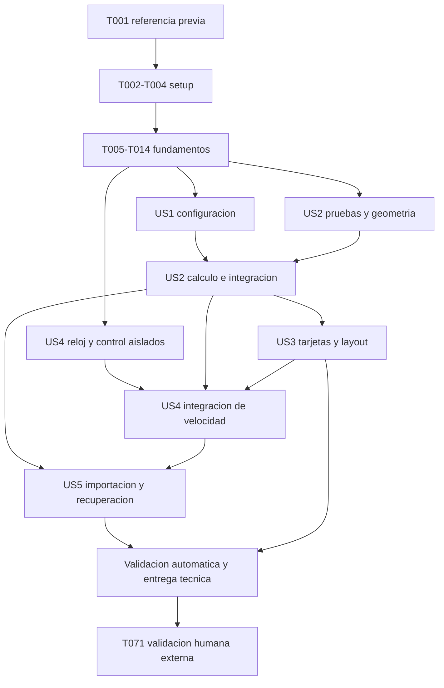

# Tasks: Velocidad de reproducción y múltiples líneas de conteo

**Feature**: `specs/011-video-multilinea-velocidad` · rama `feature/011-video-multilinea-velocidad` · checkout principal ·2026-11-25.

**Input**: [plan.md](plan.md), [spec.md](spec.md), [research.md](research.md), [data-model.md](data-model.md), [contracts/README.md](contracts/README.md), [contracts/schemas.json](contracts/schemas.json), [contracts/ui.md](contracts/ui.md) y [quickstart.md](quickstart.md).

**Tests**: Requeridas por los escenarios/criterios de la especificación y la constitución; se incluyen pruebas por historia y regresiones de imagen/video. Escribir primero los casos del comportamiento ausente y comprobar fallo significativo antes de implementarlo; las regresiones de comportamiento ya existente deben seguir pasando, no se fuerza su fallo.

**Estado**:74/75 tareas técnicas/documentales completadas. T071 permanece pendiente de validación con cinco personas; SC-009 no aprobado. Ver `validation.md` y `evidence/`.

**Formato**: `- [ ] Tnnn [P opcional] [USn en historias] acción/path`. `[P]` permite ejecutar junto a otra tarea lista de archivos distintos DESPUÉS de sus dependencias/gates; no autoriza editar el mismo archivo en paralelo. Las tareas sin story son setup/fundamentos/transversales. No tocar pesos, umbral, hilos, intervalo, .env privado ni archivos previos ajenos.

**Regla temporal**: data-model§10 y contrato `valid_until_us` definen la reutilización exacta entre cuadros; «saltar» contexto invalida respuestas de seek anterior, avanzar normalmente dentro del intervalo no obliga a una request por RAF.

## Phase 1: Setup — referencia previa y fixtures

**Goal**: Capturar base antes de cualquier cambio de producto y preparar entorno aislado.

**Independent Test / Checkpoint**: Referencia011 de escritura única guardada; solo luego pueden editarse manifiestos/app. Los [P] aquí arrancan después de T001.

- [X] T001 Crear y ejecutar el harness independiente `backend/tests/performance/test_count_lines_overhead.py` en modo capture ANTES de modificar backend/app o frontend/src: publicación actual de300cuadros×20observaciones, un calentamiento y cinco muestras; guardar hash fuente/entorno/parámetros/medianas en `specs/011-video-multilinea-velocidad/evidence/publication-baseline.json` con escritura única. No usar modelos/medios privados ni sobrescribir la referencia010. [SC-010]

- [X] T002 [P] Preparar `backend/tests/fixtures_011.py` y `frontend/tests/fixtures/countLines011.ts` desde los11esquemas y ejemplos aprobados: seis nombres reales Car/Bus/Truck/Big Truck/Motorbike/Van, trayectorias opuestas, dos/diez segmentos, IDs estables, prefijos y estados. Conservar aparte9positivos/12negativos estructurales/10semánticos; no tratarlos como validación de producto ya realizada. Depende de T001. [FR-013; SC-002, SC-010]

- [X] T003 [P] Declarar dependencia directa `regex>=2025,<2027` en `backend/pyproject.toml` y fijarla en `backend/uv.lock` usando el entorno Python3.12; verificar importación y mantener versiones de modelos/runtime existentes. No recrear entorno con3.15 ni editar .env privado. Depende de T001. [FR-005]

- [X] T004 [P] Crear fixture aislada `backend/tests/e2e/serve_video_multiline_011.py`, setup `frontend/e2e/multilineSetup.ts` y `frontend/playwright.011.config.ts`: video e imagen sintéticos, seis clases, cruces opuestos y prefijo ampliable/controlado. Reutilizar patrón009/010 con API/gateway/Vite propios, sin secretos; documentar arranque y limpieza de procesos de prueba. Depende de T001. [SC-002, SC-004, SC-005, SC-006, SC-010]

---

## Phase 2: Foundational — contratos, límites y almacenamiento

**Goal**: Prerrequisitos comunes para todas las historias.

**Independent Test / Checkpoint**: T014 es el gate: deben estar completas T001–T014, incluidos parser, configuración, store y lifecycle antes de integrar historias.

- [X] T005 [P] Añadir `backend/tests/contract/test_count_lines_models.py`: los11DTO cerrados contra9ejemplos válidos y12negativos de forma; preparar pruebas de los10negativos semánticos para completar en sus historias. Afirmar límites SafeInt, UUID, bool rechazado como número, coordenadas finitas, literales y campos adicionales; no ampliar modelos010. Depende de T002.

- [X] T006 [P] Añadir pruebas del parser nuevo en `frontend/tests/features/video-analysis/countLinesContracts.test.ts`: ejemplos positivos, negativos de forma, invariantes ready/pending/unavailable, intervalos exclusivos, total nulo y contexto/revisiones/IDs. Cubrir formatos UUID/fecha y enteros seguros sin reutilizar el parser010 ni contar UTF-16 como grafemas. Depende de T002.

- [X] T007 Definir Point/Segment/LineWrite/CollectionWrite/LegacyImport en `backend/app/domain/count_lines.py` desde contracts/schemas.json. Citar límites: «UUID de generación/línea, enteros seguros0..2^53−1 y tiempos fuente en microsegundos», «Máximo32 objetos en transporte», «x/y finitos0..1; extremos distintos». generation/expected_revision/lines obligatorios; nombre1..1024codepoints de transporte, colorRGB de seis dígitos y line_id UUID. Objetos cerrados, sin dirección y sin coerción bool/números. Depende de T005, T003.

- [X] T008 Completar los DTO LineConfig/Limits/LegacyImportState/Collection/CountValue/CountSnapshot en `backend/app/domain/count_lines.py`: protocol=video-count-lines-v1, policy_version=finite-center-both-v1, mode=both; geometry_revision≥1, origin user|legacy_import, status pending|ready|unavailable, result_scope building|partial|final, analysis_state queued|analyzing|complete|partial_failed, import none|offered|imported. Todos los campos requeridos del esquema, admitted_count y tiempos SafeInt, expires_at fecha válida,32colores únicos y null solo donde el esquema lo permite; error_code null|reanalysis_required|count_work_limit|count_reducer_failed. Aplicar «Pending y unavailable devuelven total=null» y las relaciones de data-model§10. Depende de T007.

- [X] T009 [P] Añadir `backend/tests/unit/test_count_lines_config.py` con límites por defecto y extremos:10activas dentro10..32,128admitidas≥activas y≤1024, lotes1..20, pares1..200 y presupuesto positivo≤10ms. Rechazar incoherencias/bool; configuración de prueba aislada sin .env privado. Depende de T002.

- [X] T010 Incorporar en `backend/app/core/config.py` VIDEO_COUNT_MAX_LINES=10, VIDEO_COUNT_MAX_ADMITTED_LINES=128, VIDEO_COUNT_REDUCER_BATCH_FRAMES=20, VIDEO_COUNT_REDUCER_MAX_PAIRS=200 y VIDEO_COUNT_REDUCER_BUDGET_MS=5, con las validaciones aprobadas; ejemplos sin secretos en `backend/.env.example`. Techos no configurables:32objetos/protocolo,2MiB por captura y2048bytes por nombre. Depende de T009. [FR-001; SC-001]

- [X] T011 [P] Añadir `backend/tests/integration/test_count_lines_storage.py` solo para creación/reapertura aditiva de tablas p_count_lines_*, claves/índice temporal y purge de filas sembradas directamente por fixtures, sin invocar el servicio de colección ni sus rutas. Verificar que bootstrapping no borra ni altera p_directed_count_*, inventario o TTL del padre. Descriptor funcional vacío y cuotas de admisión pertenecen a T015/T016 en US1, no al gate de fundamentos. Depende de T002.

- [X] T012 Crear `backend/app/services/count_lines_store.py` con tablas collection/lines/tracks/events, claves e índice descritos en data-model§1–4; misma conexión/lock de ProgressiveStore y transacciones sin BEGIN anidado. Conservar «Una fila por `(job,generation)`», claves de trayectoria/evento `(job,generation,line_id,geometry_revision,track_id)`, ordinal estable, cursor/cobertura, hash/expected_revision de última PUT y marcador/fingerprint de importación. No crear estados mediante GET. Depende de T011, T008.

- [X] T013 Crear `frontend/src/features/video-analysis/countLinesContracts.ts` con tipos y parser cerrado específico011 según schemas.json: límites/literales/nullabilidad, UUID/fecha, IDs únicos, revisiones y valid_until_us. Validar ready/total, cantidades/cobertura/intervalos contra snapshot; conservar intacto inspectionContracts.ts y anunciar que grafemas/uniquidad normalizada tienen autoridad backend. Depende de T006, T008.

- [X] T014 Definir recurso de ciclo de vida en `backend/app/services/count_lines_store.py` y su inyección base en `backend/app/core/lifespan.py`, registrando detail_resources/paths/purge con ProgressiveStore. Parent/owner/generation/TTL obligatorios y limpieza de todas las tablas al retirar/vencer; sin archivos ni TTL nuevos. Este checkpoint requiere todas las tareas de Setup/Foundation completas antes de integrar historias; sus pruebas verifican los DTO/configuración y el almacenamiento/lifecycle disponibles en T007–T014. No exige lógica de descriptor ni cuotas del servicio T019–T020, cuyas pruebas y cierre corresponden a US1 (T015/T016). Depende de T012, T010, T013, T004. [FR-024]

---

## Phase 3: User Story 1 — Configurar varias líneas con nombre (P1)

**Goal**: Crear/dibujar/editar/persistir varias líneas sobre el primer fotograma.

**Independent Test / Checkpoint**: Configurar AV SIMÓN BOLIVAR/RUTA VIVA y diez líneas, ajustar una sin mover otra y conservarlas al iniciar análisis. Este MVP configura; aún no acredita el cálculo de cruces.

- [X] T015 [P] [US1] Añadir `backend/tests/contract/test_count_line_collection.py` para GET/PUT: generación obligatoria, cuerpo cerrado, JSON/no-store, descriptor funcional vacío revision0/admitted_count0/lines[] sin INSERT, CAS y los códigos de conflicto. Estas pruebas de servicio/ruta se escriben antes de implementar US1 y se satisfacen con T020–T022, no para cerrar T014. Contrastar respuestas con contratos y certificar que GET no crea líneas ni importa un segmento anterior. Depende de T014. [FR-001, FR-002, FR-014, FR-015, FR-026; SC-001]

- [X] T016 [P] [US1] Añadir `backend/tests/integration/test_count_line_mutations.py`: alta de10líneas, nombres/color duplicados y swap atómico, concurrencia de pestañas, rollback total, no-op/reordenación, respuesta perdida, límite activo y cuota de admisión incluyendo tombstones/admitted_count, y UUID rechazado tras borrado. Los casos de cuotas se satisfacen con T019–T020 en US1 y no se exigen para cerrar fundamentos. Verificar que metadatos no reinician eventos/cursor y mover/eliminar solo afecta a la línea elegida. Depende de T014. [FR-001, FR-002, FR-005, FR-006, FR-007, FR-014, FR-015, FR-026; SC-001, SC-007]

- [X] T017 [P] [US1] Añadir `frontend/tests/features/video-analysis/countLineDrafts.test.tsx` y `countLineEditor.test.tsx`: primer fotograma local, dos/diez UUID, borrador vs confirmado, cancelar/error conserva geometría, extremos/traslación completa suaves con clamp y teclado, selección de superpuestas, revocación de URL y reset al cambiar archivo; ninguna PUT por pointermove. Depende de T014. [FR-003, FR-004, FR-015; SC-001, SC-006]

- [X] T018 [US1] Implementar reglas en `backend/app/domain/count_lines.py` y corpus `backend/tests/unit/test_count_line_labels.py`: «Límite de1–60 grafemas extendidos; hasta2048 bytes UTF-8 y1024 codepoints de techo de transporte», «normalizar NFC, eliminar espacios exteriores y colapsar espacios Unicode redundantes; conservar letras/acentos/caja» y «NFC+casefold del nombre normalizado, sin quitar tildes». Rechazar vacío/controles/bidi inseguros; probar emoji/ZWJ y1/60/61grafemas. Color: «#RRGGBB mayúsculo» con unicidad por valorRGB;32candidatos únicos del descriptor. Depende de T007, T003, T015. [FR-005, FR-006; SC-001, SC-007]

- [X] T019 [US1] Implementar mutación diferencial transaccional en `backend/app/services/count_lines_store.py`: expected_revision+hash canónico, IDs únicos, capacidades/tombstones, creación ordinal/geometry_revision1 y eliminaciones; «Reordenar el array sin cambiar campos no constituye edición». Cambiar nombre/color conserva estado; geometría incrementa solo su revisión y limpia solo sus filas antiguas. Admitidas128incluye eliminadas; si se reduce capacidad operativa permitir metadata/bajas y rechazar solo altas netas. No exponer valores temporales al intercambiar etiquetas. Depende de T012, T016, T018. [FR-001, FR-002, FR-007, FR-014, FR-015, FR-026; SC-001, SC-007]

- [X] T020 [US1] Crear `backend/app/services/count_lines_service.py` para descriptor y PUT completo `{generation,expected_revision,lines}`; «Línea omitida equivale a eliminación explícita del conjunto que el cliente confirmó». Padre autorizado primero; devolver límites efectivos, admitted_count, paleta, origen/import ofrecido y TTL sin insertar al consultar. Reintento exacto de última PUT reconoce hash/revisión; otra revisión devuelve409 y cualquier fallo revierte todo; no reenviar colección antigua contra cambios ajenos. Depende de T019, T015, T010. [FR-001, FR-002, FR-014, FR-015, FR-024, FR-026; SC-001, SC-008]

- [X] T021 [US1] Exponer solo GET/PUT colección en `backend/app/api/routes/video_count_lines.py` e integrar router/servicio en `backend/app/main.py` y `backend/app/core/lifespan.py`. GET acepta solo generation; PUT cuerpo obligatorio sin query; rechazo de query repetida/desconocida y validación estricta. Registrar familia count-lines en bounded_video_detail,64KiB y no-store; conservar todos los DTO/rutas010. Depende de T020. [FR-001, FR-002, FR-024, FR-026]

- [X] T022 [US1] Añadir GET/PUT colección a ROUTES/classify de `backend/app/web/proxy.py` y pruebas `backend/tests/contract/test_count_lines_gateway.py`: allowlist exacta, query por método,64KiB/no-store/JSON≤2MiB, sesión/CSRF/origen e inyección de APIkey solo en gateway. No wildcard, rutas codificadas/dobles/dot segments ni secretos en frontend. Depende de T021. [FR-024, FR-026]

- [X] T023 [US1] Adaptar `frontend/src/features/video-analysis/useCountDraft.ts` a colección UUID con nombre/color/segmento y selección; preservar captura/revocación de primer fotograma. Nombre inicial único «Línea N» y primer color libre; confirmar límites del descriptor. Mantener drafts al fallar/reconciliar y marcar aplicado solo tras respuesta confirmada o GET equivalente, nunca antes del await. Depende de T017, T013. [FR-002, FR-003, FR-005, FR-006, FR-015, FR-026; SC-001, SC-008]

- [X] T024 [US1] Adaptar `frontend/src/features/video-analysis/ProgressiveCountTools.tsx` al ID seleccionado, con controles básicos de Añadir línea, nombre, selección y aplicar/cancelar borrador para que US1 sea usable antes de las tarjetas:  dibujar y arrastrar extremos/segmento completo con pointer capture/clamp, Arrow/Shift+Arrow, primer fotograma y cancelar/limpiar solo borrador elegido. Quitar flecha, dirección e Invertir sentido del editor nuevo; segmentos superpuestos se seleccionan por lista estable. No modificar otras líneas ni hacer requests durante el arrastre. Depende de T023. [FR-003, FR-004, FR-009, FR-010, FR-015; SC-001, SC-006]

- [X] T025 [US1] Crear operaciones de colección/CAS en `frontend/src/features/video-analysis/useCountLines.ts` y enlazar `VideoWorkspace.tsx` con el editor inicial. Un flujo serializado por colección, recuperación GET ante respuesta perdida/409 y parser nuevo; confirmar solo el conjunto normalizado del servidor. No sobrescribir otra pestaña, no duplicar initial drafts ni habilitar conteo direccional como fallback. Depende de T024, T022. [FR-001, FR-002, FR-003, FR-015, FR-026; SC-001, SC-008]

- [X] T026 [US1] Crear y ejecutar `frontend/e2e/video-line-configuration.011.spec.ts`: AV SIMÓN BOLIVAR/RUTA VIVA y hasta10líneas desde primer fotograma, arrastre/teclado, cancelar inválida, persistencia al iniciar análisis y edición aislada. Guardar resultados/capturas sintéticos en `specs/011-video-multilinea-velocidad/evidence/line-configuration.json`; no afirmar cruces implementados por este checkpoint. Depende de T025, T004. [FR-001, FR-003, FR-004, FR-005, FR-015; SC-001, SC-006]

---

## Phase 4: User Story 2 — Contar cruces en ambos sentidos (P1)

**Goal**: Contar mediciones reales una vez por identidad/línea y consultar cantidades históricas exactas.

**Independent Test / Checkpoint**: Seis clases, dos sentidos, identidad en dos líneas, contactos/prolongaciones y10seeks dan totales correctos sin predicción/futuro; intervalos evitan una petición por cuadro.

- [X] T027 [P] [US2] Añadir `backend/tests/unit/test_bidirectional_crossings.py`: seis clases, cruces en ambos sentidos, dos vehículos simultáneos, identidad repetida/multilínea, contactos/tangencias/inicio sobre línea/extremos/prolongaciones. Clase no elegible no consume futuro cruce; clase confirmatoria inmutable y predicción no suma. Mantener tests de política direccional anterior. Depende de T014. [FR-010, FR-011, FR-012, FR-013; SC-002, SC-003]

- [X] T028 [P] [US2] Añadir `backend/tests/integration/test_count_lines_reduction.py`: round-robin1/10líneas, edición/borrado/TTL durante cómputo fuera del lock, cursor obsoleto, límite de bytes antes de materializar, no-op metadata y aislamiento de error. Comprobar que se confirman solo cuadros completos, sin duplicados ni huecos, y publicación/inventario no quedan monopolizados. Depende de T014, T020. [FR-011, FR-012, FR-014, FR-015, FR-024, FR-026; SC-001, SC-002, SC-010]

- [X] T029 [P] [US2] Añadir `backend/tests/contract/test_count_lines_snapshots.py`: GET counts requiere generation/revision/at_us, todos los IDs/revisiones del conjunto, nulos/estados, zero confirmado, cobertura exclusiva y valid_until_us mínimo del siguiente evento/cobertura/prefijo. GET nunca reduce/importa/escribe. Ejercitar negativos semánticos de contratos y respuesta de cobertura parcial/fallida. Depende de T014, T020. [FR-012, FR-014, FR-016; SC-002, SC-003, SC-008]

- [X] T030 [P] [US2] Añadir `frontend/tests/features/video-analysis/countSnapshots.test.tsx` y `countProjection.test.ts`: un poller agregado, intervalo exacto entre cuadros, límite exclusivo,20intentos futuros/10seeks, descartes por generación/revisión/UUID/geometry_revision/secuencia, una tarjeta pending no vacía las otras y respuesta antigua de seek no repinta. Fake clock verifica400ms/una petición en vuelo/100ms mínimo. Depende de T014. [FR-012, FR-016, FR-020, FR-026; SC-003, SC-005, SC-008]

- [X] T031 [US2] Extraer o ampliar explícitamente la geometría en `backend/app/services/directed_counting.py` para modo ambos sentidos sin reinterpretar el contrato anterior. Conservar «segmento inclusivo, preservando la tolerancia vigente1e−6píxel para lado y1e−12para intersección»; usar centros raw medidos y catálogo compartido, clase inmutable al confirmar. Evento único por track/línea/revisión, sin usar maxTrackID ni sumar inventario. Depende de T027. [FR-010, FR-011, FR-012, FR-013; SC-002]

- [X] T032 [US2] Crear `backend/app/services/count_lines_reducer.py`: capturar líneas alineadas y leer/decodificar cada frame una vez, máximo20cuadros/200pares cuadro-línea/2MiB, verificando longitudes antes de materializar. Cómputo fuera del lock con5ms cooperativos comprobados entre cuadros; confirmar prefijo íntegro con CAS de padre/generación/no borrada/geometry_revision/cursor. Preservar «un cuadro predicho no altera trayectoria ni votos del contador» aunque avance cobertura; reanalysis_required/count_work_limit solo afecta sus líneas. Depende de T031, T019, T028. [FR-011, FR-012, FR-013, FR-014, FR-024, FR-026; SC-001, SC-002, SC-010]

- [X] T033 [US2] Integrar el reducer en `backend/app/services/video_detail_worker.py` y `backend/app/core/lifespan.py`: turnos round-robin entre trabajos/líneas, liberar lock entre capturas/commits y respetar cierre cooperativo. Mantener espacio para publicación, inspección, inventario y consumidor direccional anterior. Logs/métricas solo IDs opacos/revisiones/latencias/cobertura, sin nombres/placas/rutas; no crear un thread ni inferencia por línea. Depende de T032, T014. [FR-014, FR-024, FR-025; SC-010]

- [X] T034 [US2] Implementar snapshot consistente bajo lock en `backend/app/services/count_lines_service.py` e índices de `count_lines_store.py`: total=count(event.time_us<=at_us), «Pending y unavailable devuelven total=null»; result_scope building|partial|final y línea parcialmente cubierta no es final. «Un ready exige at_us<valid_until_us≤covered_until_us y≤available_until_us»; valid_until_us=min(próximo evento estrictamente posterior,cobertura,prefijo), pending/unavailable extremo=at_us. Con prefijo vacío aceptar0pending; futuro409; no mutar DB al GET. Depende de T032, T029, T020. [FR-012, FR-014, FR-016; SC-002, SC-003, SC-008]

- [X] T035 [US2] Crear `frontend/src/features/video-analysis/countProjection.ts` y completar `countLinesContracts.ts`: cantidad exacta reutilizable solo en `[snapshot.at_us,line.valid_until_us)` del mismo contexto; fuera mostrar actualizando en esa tarjeta, no un número atrasado ni futuro. Rechazar inconsistencias total/estado/intervalo/IDs/revisiones; un salto de navegación invalida respuestas en vuelo anteriores. Depende de T034, T013, T030. [FR-016, FR-020, FR-026; SC-003, SC-005, SC-008]

- [X] T036 [US2] Añadir GET `/playback/count-lines/counts` en `backend/app/api/routes/video_count_lines.py` y allowlist/query de `backend/app/web/proxy.py`: generation/revision/at_us obligatorios SafeInt/UUID, sin cuerpos ni queries repetidas/desconocidas, no-store, autoridad del padre. Mantener descriptor/PUT y rutas010 sin alteraciones. Depende de T034, T022. [FR-016, FR-024; SC-003, SC-008]

- [X] T037 [US2] Implementar consulta agregada en `frontend/src/features/video-analysis/useCountSnapshots.ts` y enlace con `useCountLines.ts`:400ms visible/activo, demanda coalescida tras seek o fin de validez, una en vuelo y100ms entre inicios. Usar start_us del cuadro pintado; distinguir secuencia de navegación de avance ordinario para reutilizar intervalos exactos. Abortar/filtrar por contexto, no diez pollers ni una request por RAF. Depende de T035, T036, T030. [FR-012, FR-016, FR-020, FR-026; SC-003, SC-005, SC-010]

- [X] T038 [US2] Integrar líneas confirmadas y snapshot en `frontend/src/features/video-analysis/ProgressiveVideoPlayer.tsx`: pasar frame.start_us pintado al hook, dibujar todos los segmentos con contorno/color y selección, repintar con presentationRevision/ID en vez de JSON.stringify por RAF. Retirar directionArrow/configuración de sentido del flujo nuevo conservando el API anterior aislado; no alterar inspección/PTS/fuente/exportación. Depende de T037, T033, T025. [FR-009, FR-010, FR-012, FR-013, FR-016, FR-025; SC-002, SC-003, SC-010]

- [X] T039 [US2] Crear y ejecutar `frontend/e2e/video-multiline-counts.011.spec.ts` con seis clases/opuestos, un vehículo en dos líneas, contactos, diez seeks y estados parciales; comprobar total por instante exacto y ausencia de duplicados/futuros. Guardar evidencia sintética `specs/011-video-multilinea-velocidad/evidence/counts.json`; ninguna cardinalidad se deduce del máximo TrackID ni se confunde con inventario global. Depende de T038, T004. [FR-010, FR-011, FR-012, FR-013, FR-014, FR-016; SC-002, SC-003, SC-008]

---

## Phase 5: User Story 3 — Tarjetas superiores y color editable (P1)

**Goal**: Vincular nombre/color/cantidad por línea en una barra superior accesible.

**Independent Test / Checkpoint**: Tres/diez tarjetas, recolorear/renombrar desde una sin reinicio y seleccionar segmentos superpuestos; teclado/tacto/fullscreen360/768/1440 sin overflow.

- [X] T040 [P] [US3] Añadir `frontend/tests/features/video-analysis/countLineBar.test.tsx`: diez tarjetas con nombres accesibles/cantidad/estado, selección UUID, colores sólidos editables desde tarjeta, nombres largos y coincidencia con línea. Eliminar no restaura una tarjeta ante respuesta tardía y los estados pending/parcial/unavailable no se presentan como cero. Depende de T014. [FR-006, FR-008, FR-009, FR-016, FR-023, FR-026; SC-006, SC-007]

- [X] T041 [P] [US3] Ampliar pruebas aisladas en `backend/tests/integration/test_count_line_metadata.py`: rename/recolor sobre líneas con eventos no modifica geometry_revision/cursor/eventos; swap atómico válido de nombres/colores, duplicado rechaza todo y reducir capacidad no impide metadata/bajas. Verificar admitted_count incluye tombstones y actualiza solo al admitir IDs nuevos. Depende de T020, T034. [FR-005, FR-006, FR-007, FR-015, FR-026; SC-001, SC-007]

- [X] T042 [P] [US3] Preparar `frontend/e2e/video-counter-layout.011.spec.ts` con casos360/768/1440, diez tarjetas/nombres60grafemas, tacto/teclado/foco y fullscreen. Afirmar barra dentro de progressive-viewer por encima de progressive-surface, sin overlay numérico único, sin overflow horizontal ni controles sobre vehículos; guardar capturas de fixture. Depende de T004, T014. [FR-008, FR-009, FR-023; SC-006]

- [X] T043 [US3] Crear `frontend/src/features/video-analysis/CountLineBar.tsx`: tarjeta por UUID con nombre completo accesible, swatch, cantidad exacta o estado y selección; no usar color/posición/TrackID como identidad ni sumar tarjetas como total único. Mantener texto neutro legible y focus/selection además de color; acciones con área mínima44px. Depende de T040, T013. [FR-008, FR-009, FR-012, FR-016, FR-023; SC-006, SC-007]

- [X] T044 [US3] Añadir controles de nombre/color y eliminar/cancelar en `frontend/src/features/video-analysis/CountLineBar.tsx`, usando mutaciones serializadas de `useCountLines.ts`: primer color libre de32candidatos, bloquear duplicadoRGB y explicar antes de confirmar. Feedback de grafemas con Intl.Segmenter si existe; servidor autoritativo, sin maxlength60UTF16. Reflejar datos normalizados conjuntamente en tarjeta/editor, conservar confirmado ante error. Depende de T043, T041, T020. [FR-005, FR-006, FR-007, FR-015, FR-026; SC-007]

- [X] T045 [US3] Montar CountLineBar antes de la escena y dentro del root fullscreen en `frontend/src/features/video-analysis/ProgressiveVideoPlayer.tsx`; vincular selección con `ProgressiveCountTools.tsx` para elegir una línea superpuesta por tarjeta sin arrastrar otras. Retirar overlay de contador único/copy de flecha; conservar ficha y anotaciones de vehículos. Depende de T044, T038. [FR-008, FR-009, FR-010, FR-023, FR-025; SC-006, SC-010]

- [X] T046 [US3] Adaptar `frontend/src/styles.css` para barra/tarjetas, controles y editor a360/768/1440: min-width0, wrapping/grupos accesibles, foco visible y contornos. En fullscreen sustituir alto fijo75vh por espacio de escena restante reservado tras barra/controles; no overlay sobre autos ni scroll horizontal de la página, nombres completos consultables y objetivos táctiles44px. Depende de T045, T042. [FR-008, FR-009, FR-023; SC-006]

- [X] T047 [US3] Ejecutar regresiones de `frontend/e2e/video-counter-layout.011.spec.ts` y `video-counter-editing.011.spec.ts`: cambiar desde tarjeta nombre/color y comprobar asociación y cantidades sin reinicio; selección de coincidencias y edición de una línea de diez. Medir reflejo confirmado<1s en fixture y guardar `specs/011-video-multilinea-velocidad/evidence/counter-cards.json` con capturas y límites. Depende de T046, T040, T004. [FR-005, FR-006, FR-007, FR-008, FR-009, FR-023; SC-006, SC-007]

---

## Phase 6: User Story 4 — Velocidad de reproducción (P2)

**Goal**: Cambiar el ritmo del reloj canvas sin alterar fuente, análisis ni cantidades.

**Independent Test / Checkpoint**: Tramo30scompleto a0,5×/1×/2× dura60/30/15s±5%; cambio pausado mantiene cuadro y buffer/futuro/intención siguen seguros.

- [X] T048 [P] [US4] Añadir `frontend/tests/features/video-analysis/playbackClock.test.ts`: presets0.25/0.5/0.75/1/1.25/1.5/2, rate1inicial y reset por video; muestreo continuo con rate antiguo al mismo now, cambios sucesivos, pausa/buffer sin ancla, seek y documento oculto sin catch-up. Probar que reanclar no multiplica retroactivamente tiempo transcurrido. Depende de T014. [FR-017, FR-018, FR-019, FR-020; SC-004, SC-005]

- [X] T049 [P] [US4] Añadir `frontend/tests/features/video-analysis/playbackRateControl.test.tsx`: siete opciones, selección visible/accesible con teclado/tacto, cambio en pausa no inicia reproducción ni OCR y conserva selección de vehículo. Un video nuevo1× y pestaña del mismo trabajo conserva rate; no prometer acelerar análisis. Depende de T014. [FR-017, FR-018, FR-019, FR-023; SC-004, SC-006]

- [X] T050 [P] [US4] Añadir `frontend/tests/features/video-analysis/playbackRateIntegration.test.tsx`: rate no recrea SourceDecoder/cache ni modifica timestamps frame_index×1000/PTS; cajas y cantidades del frame pintado siguen contexto. Incluir wait→resume, pausa explícita al esperar y límites de prefetch/colas existentes, sin conteo derivado de cuadros de presentación omitidos. Depende de T014. [FR-018, FR-019, FR-020, FR-025; SC-003, SC-004, SC-005, SC-010]

- [X] T051 [US4] Crear módulo puro `frontend/src/features/video-analysis/playbackClock.ts` con «ancla opcional wall_ms/source_us/rate» y rate restringido a los siete presets. target=source_us+(now-wall_ms)*1000*anchor.rate; cambiar rate muestrea con el anterior y reancla al mismo now. Pausa/espera dejan ancla ausente y conservan cuadro/intención; nada de Date.now, detección ni rescalar tiempos fuente. Depende de T048. [FR-017, FR-018, FR-019, FR-020; SC-004, SC-005]

- [X] T052 [US4] Crear `frontend/src/features/video-analysis/PlaybackRateControl.tsx` con select accesible0,25×–2×/1×inicial y estilos compartidos; onChange solo comunica preset válido, sin seek ni reproducción implícita. Usar etiquetas de velocidad y diseño coherentes con controles actuales. Depende de T049, T051. [FR-017, FR-018, FR-023; SC-004, SC-006]

- [X] T053 [US4] Adaptar el loop de `frontend/src/features/video-analysis/ProgressiveVideoPlayer.tsx` al reloj puro: mantener continuidad al cambiar rate, ancla nueva al reanudar/seek/buffering y pausa al ocultar documento/workspace conservando rate. No agregar rate a dependencias que crean decoder ni modificar límites de caches. Consultar counts por tiempo pintado, no target futuro. Depende de T051, T038, T050. [FR-017, FR-018, FR-019, FR-020, FR-025; SC-003, SC-004, SC-005, SC-010]

- [X] T054 [US4] Montar PlaybackRateControl junto a botones de reproducción en `frontend/src/features/video-analysis/ProgressiveVideoPlayer.tsx` y ajustar `frontend/src/styles.css`: cambios pausados conservan cuadro/crop; fullscreen/tacto/teclado mantienen acceso. Velocidad no solicita enriquecimiento, no cambia exportación ni cadencia y la escena solo admite cuadros/anotaciones confirmados. Depende de T052, T053, T045. [FR-017, FR-018, FR-019, FR-020, FR-023, FR-025; SC-004, SC-005, SC-006, SC-010]

- [X] T055 [US4] Ejecutar y reforzar `frontend/tests/features/video-analysis/playbackRateIntegration.test.tsx`, `sourceDecoder.test.ts` y `frameCache.test.ts` (crear este último si falta): rate no cambia instancia/PTS/tokens/caché ni excede28frames decodificados,8MiB codificada o16MiB anotaciones. Comparar detecciones/inspección/total al mismo tiempo fuente entre velocidades; una omisión visual2× no omite mediciones del servidor. Depende de T054, T050. [FR-018, FR-019, FR-020, FR-025; SC-003, SC-004, SC-005, SC-010]

- [X] T056 [US4] Crear y ejecutar `frontend/e2e/video-playback-rate.011.spec.ts`: tramo completamente analizado30s a0,5×/1×/2× dura60/30/15s±5% si el equipo sostiene referencia; cambios en marcha/pausa/wait,10seek-cycles y20intentos futuros. Guardar tiempos fuente/wall, condiciones y resultados en `specs/011-video-multilinea-velocidad/evidence/playback-rate.json`, sin convertir la medición de reproducción en FPS del detector. Depende de T055, T004. [FR-017, FR-018, FR-019, FR-020; SC-003, SC-004, SC-005]

---

## Phase 7: User Story 5 — Recuperar contexto y línea anterior (P2)

**Goal**: Restaurar trabajo vigente, importar una sola línea antigua y respetar privacidad/vencimiento.

**Independent Test / Checkpoint**: Recarga de diez líneas e importación/borrado/reintento no duplican; sin procedencia se declara no disponible y otro video/sesión no recibe contexto ajeno.

- [X] T057 [P] [US5] Añadir `backend/tests/contract/test_count_line_import.py` y `backend/tests/integration/test_count_line_legacy_import.py`: POSTcerrado generation/expected_revision, colección vacía/candidato válido, idempotencia/reinicio/borrado posterior, carreras con PUT y ausencia de observaciones. GET nunca importa, no copiar total direccional y la tabla/API010 sigue intacta. Depende de T014. [FR-021, FR-022, FR-024, FR-026; SC-008]

- [X] T058 [P] [US5] Añadir `backend/tests/integration/test_count_lines_lifecycle.py`: recuperar configuración/cursor/eventos tras reiniciar, metadata durante reducción, retirada/vencimiento concurrente y tombstones hasta TTL del padre. Purge incluye colección/line/tracks/events/recibo mínimo/import marker, sin recrear filas o prolongar fechas; error de una línea no elimina el video. Depende de T014. [FR-021, FR-024, FR-026; SC-008]

- [X] T059 [P] [US5] Añadir `frontend/tests/features/video-analysis/countLineRecovery.test.tsx`: recarga/restauración, respuesta perdida de PUT/import, una importación ofrecida, UUID borrado no reaparece, backend antiguo sin feature mantiene video e inspección,401/403/410 según autoridad vigente, respuesta tardía y cambio de video/sesión descartan contexto. No fallback direccional ni reintentos que sobreescriban otras pestañas. Depende de T014. [FR-021, FR-022, FR-024, FR-026; SC-008]

- [X] T060 [US5] Implementar importación en `backend/app/services/count_lines_service.py` y `count_lines_store.py`: POST explícito, ID determinista por generación/fingerprint, «none/offered se resuelven por lectura; imported queda persistido después del POST, incluso al borrar la línea importada». Conservar segmento/nombre Línea1/color, cursor0 para ambos sentidos, nunca cantidad anterior. Padre primero; imported repetido retorna descriptor; sin candidato409legacy_line_unavailable, colección ajena al import no vacía409legacy_import_conflict. Depende de T057, T020, T034. [FR-021, FR-022, FR-024, FR-026; SC-008]

- [X] T061 [US5] Exponer POST `/playback/count-lines/import-legacy` en `backend/app/api/routes/video_count_lines.py` y `backend/app/web/proxy.py`: body LegacyImport obligatorio sin query, allowlist exacta,64KiB/no-store/CSRF y respuesta Collection confirmada rápida sin scan/inferencia. Mantener GET colección y counts de solo lectura y contratos previos cerrados. Depende de T060, T022. [FR-021, FR-022, FR-024; SC-008]

- [X] T062 [US5] Completar recuperación y retiro en `backend/app/services/count_lines_store.py`, `video_detail_worker.py` y `backend/app/core/lifespan.py`: reanudar cursores vigentes, conservar eventos confirmados, invalidar trabajo capturado tras edición/retirada, limpiar estados/tombstones con TTLpadre y no ampliar fechas. Ausencia de procedencia pasa esa línea a unavailable/reanalysis_required, no a cero ni error global. Depende de T058, T033, T014, T060. [FR-021, FR-022, FR-024, FR-026; SC-008]

- [X] T063 [US5] Completar `frontend/src/features/video-analysis/useCountLines.ts` y `useCountSnapshots.ts`: restaurar descriptor confirmado al reabrir, importar una sola vez cuando está offered/vacío/activo y conciliar antes de reintentar. Distinguir parcial/pending/no disponible de cero; sin observaciones explicar nuevo análisis. Mantener estado en errores recuperables y no resucitar UUIDdeleted; feature404 afecta solo tarjetas, no retira un video reproducible. Depende de T059, T061, T037, T054. [FR-016, FR-021, FR-022, FR-024, FR-026; SC-008]

- [X] T064 [US5] Conectar reset/limpieza del contexto en `frontend/src/features/video-analysis/useCountDraft.ts`, `VideoWorkspace.tsx` y `ProgressiveVideoPlayer.tsx`: mismo trabajo conserva líneas y rate al cambiar pestaña, nuevo archivo/generación/sesión descarta drafts/selection/requests y empieza1×; recarga puede iniciar1× sin perder líneas vigentes. No extender TTL por ninguna acción. Depende de T063, T023. [FR-017, FR-021, FR-024, FR-026; SC-008, SC-010]

- [X] T065 [US5] Crear y ejecutar `frontend/e2e/video-count-recovery.011.spec.ts`: recuperar10líneas al recargar, importar una línea antigua y recalcular ambos sentidos, borrar/importar otra vez sin reaparición, caso sin procedencia y vencimiento/cambio de sesión. Guardar agregados sin datos privados en `specs/011-video-multilinea-velocidad/evidence/recovery.json`. Depende de T064, T062, T004. [FR-021, FR-022, FR-024, FR-026; SC-008]

---

## Phase 8: Polish — validación transversal, evidencia y entrega

**Goal**: Verificar seguridad/compatibilidad/rendimiento y documentar entrega técnica con gates externos visibles.

**Independent Test / Checkpoint**: No confundir suite sintética, benchmark, prueba humana y evaluación larga. T071requiere personas; si falta, queda pendiente y el cierre técnico conserva esa limitación.

- [X] T066 Ejecutar matriz de permisos/cuerpos/query para las cuatro operaciones en `backend/tests/contract/test_count_lines_gateway.py` y `test_count_lines_security.py`: propietario ajeno, UUID/revisiones inseguros/bool, duplicados y query desconocida, rutas codificadas, CSRF/origen,64KiB,JSON2MiB,no-store,TTL y ninguna clave/ruta privada expuesta. Registrar `specs/011-video-multilinea-velocidad/evidence/security.json`. Depende de T061, T062, T036. [FR-024, FR-026; SC-008]

- [X] T067 Ejecutar pytestbackend, Vitestfrontend y buildTypeScript/Vite desde quickstart.md, incluyendo regresiones imagen/video/inspección/exportación/catálogo. Adaptar `frontend/e2e/video-directed-count.010.spec.ts` y `video-count-touch.010.spec.ts` a UI sin flecha manteniendo pruebas contractuales de API010 direccional; registrar comandos/números reales/advertencias en `specs/011-video-multilinea-velocidad/evidence/test-summary.json`. Depende de T065, T047, T056, T066. [FR-013, FR-025; SC-010]

- [X] T068 Añadir modo compare al harness `backend/tests/performance/test_count_lines_overhead.py` y reporte breve `backend/scripts/report_count_lines_overhead.py`: misma fixture300×20, hash/entorno/cinco muestras,0/1/10líneas steady/catch-up, captura/cómputo/lock/commit/GET/lag/memoria. Comparar contra referencia T001 sin sobrescribirla; guardar `specs/011-video-multilinea-velocidad/evidence/count-lines-overhead.json` sin modelos reales. Depende de T001, T033, T034. [SC-010]

- [X] T069 Evaluar el reporte en `specs/011-video-multilinea-velocidad/evidence/performance-review.md`: objetivos sintéticos p95lock≤10ms,GET≤250ms,catch-up10líneas≤5s; investigar publicación0líneas>5% frente a base con paresAB/BA sin sustituir referencia. Si incumple, ajustar tamaño/presupuesto en `backend/app/services/count_lines_reducer.py` y volver a medir sus regresiones; conservar fallos y límites, no reclamar FPS ni equivalencia de tiempo real. Depende de T068. [SC-010]

- [X] T070 Ejecutar matriz final `frontend/playwright.011.config.ts` desktop/tablet/mobile con10líneas, metadatos desde tarjeta, sincronización exacta/valid_until,30s a0,5/1/2,20intentos futuros y10seeks; imagen/video y fullscreen/tacto/teclado con360/768/1440. Consolidar capturas sintéticas, casos, omisiones reales y condiciones en `specs/011-video-multilinea-velocidad/evidence/browser-summary.json`; un navegador no compatible no acredita reproducción aprobada. Depende de T067, T069. [FR-023, FR-025; SC-001, SC-002, SC-003, SC-004, SC-005, SC-006, SC-007, SC-008, SC-010]

- [ ] T071 Realizar validación SC-009 con cinco personas y registrar resultado real en `specs/011-video-multilinea-velocidad/human-validation.md`: al menos4/5crean AV SIMÓN BOLIVAR/RUTA VIVA, cambian color desde tarjeta y eligen0,5× en<3min sin ayuda. Si faltan participantes, mantener esta tarea pendiente y dejarlo escrito; no sustituirla por E2E ni impedir commit de la entrega técnica ya verificada. No contactar personas por herramientas sin autorización. Depende de T070. [SC-009]

- [X] T072 Actualizar `specs/011-video-multilinea-velocidad/quickstart.md`, `contracts/README.md`, `backend/.env.example` y documentación de contratos reales: rutas/DTO/límites/defaults/rate, mensajes de capacidad y recuperación, nuevas dependencias fijadas y compatibilidad. No pegar claves ni rutas de videos privados; indicar que velocidad no acelera análisis ni altera exportación y que tarjetas no se suman como vehículos físicos únicos. Depende de T067, T069. [FR-001, FR-017, FR-019, FR-021, FR-022, FR-024, FR-025; SC-010]

- [X] T073 Crear `specs/011-video-multilinea-velocidad/audit.md` y `validation.md`, actualizando `docs/registro-evolucion-sistema.md`: trazar cadaFR/SC a tareas/commits/evidencia, distinguir errores de implementación de validaciones humanas/largas pendientes y conservar resultados desfavorables. No declarar SC-009aprobado si T071siguependiente ni cerrar gates anteriores. Este cierre documental no depende de disponer de participantes. Depende de T070, T072. [FR-025, FR-026; SC-001, SC-002, SC-003, SC-004, SC-005, SC-006, SC-007, SC-008, SC-009, SC-010]

- [X] T074 Validar arranque y demostración controlada de `specs/011-video-multilinea-velocidad/quickstart.md` usando únicamente servicios/fixture011 de prueba; comprobar comandos desde raíz y frontend, defaults anunciados, descriptor y la independencia entre contadores por línea e inventario global. Registrar resultado en `specs/011-video-multilinea-velocidad/evidence/quickstart.json`, sin matar servicios del usuario ni iniciar comparación larga o medios privados. Depende de T072, T070. [SC-001, SC-008, SC-010]

- [X] T075 Cerrar entrega técnica en `specs/011-video-multilinea-velocidad/tasks.md` y `validation.md`: marcar solo trabajo realmente probado, mantener T071pendiente si no hubo participantes, conservar rama y cambios existentes, revisar diff y hacer commits de producto/documentos/métricas propios con trailer de causa. No incorporar45CSVajenos ni tsbuildinfo regenerado si solo fue efecto de build; registrar pendientes sin afirmar75/75 cuando falte validación externa. Depende de T073, T074. [FR-025; SC-009, SC-010]

---

## Dependencies & Execution Order

- T001 precede a toda edición de backend/app/frontend/src; T002/T003/T004 pueden coexistir después porque no comparten archivos. T014 consolida el gate de fundamentos completo.
- US1 depende solo de los fundamentos para su flujo de configuración. US2 requiere la colección para integrar el cálculo, pero geometría/pruebas pueden prepararse sin UI de tarjetas.
- US3 usa colección y snapshots de US1/US2. US4 tiene reloj/control unitariamente independientes; su integración con ProgressiveVideoPlayer se serializa después de US2/US3 para evitar conflicto sobre ese archivo.
- US5 mantiene toda la recuperación bajo el mismo contexto; importación backend usa servicio de US1/US2 y la recuperación completa requiere integración del reproductor. Sin ciclos ni dependencia de T071 para producir el commit técnico.
- Las listas «Depende de» en cada tarea constituyen las aristas detalladas. Prioridades ordenan la entrega, pero los casos aislados [P] pueden escribirse cuando sus prerequisitos estén listos. No trabajar simultáneamente en count_lines_service.py, count_lines_store.py, useCountLines.ts, ProgressiveVideoPlayer.tsx o styles.css sin una separación explícita de archivos.

## Parallel Execution Examples

| Historia | Tareas de archivos distintos listas tras sus prerequisitos | Límite de integración |
| --- | --- | --- |
| US1 | T015 contratos + T016 mutaciones + T017 editor/drafts | T018–T025 se serializan por DTO/store/hook/editor compartidos |
| US2 | T027 geometría + T028 reducer + T029 snapshots + T030 hook | No ejecutar juntos los cambios de servicio/worker/player dependientes |
| US3 | T040 tarjetas + T041 metadatos + T042 layout | T043–T046 respetan dependencias sobre componente/player/styles |
| US4 | T048 reloj + T049 control + T050 integración simulada | Módulos puros pueden avanzar aislados; T053/T054 serializan el player |
| US5 | T057 import + T058 lifecycle + T059 recuperación UI | T060–T064 integran después de servicio/player necesarios |

Estas son oportunidades de ejecución, no tareas ya lanzadas ni permiso implícito para crear agentes. Si falta un requisito o se comparte un archivo, ejecutar secuencialmente.

## Implementation Strategy

1. **MVP de configuración**: Setup+Foundation+US1 (T001–T026). Demostrar varias líneas con nombre en primer fotograma y persistencia; no afirmar que sus contadores estén listos.
2. **MVP operativo recomendado (P1)**: sumar US2+US3 (T027–T047). Cruces bidireccionales por línea y tarjetas superiores con colores editables; validar antes de añadir velocidad.
3. **Incrementos P2**: US4 y US5 completan ritmo de reproducción, recuperación e importación sin tocar detección. Sus módulos aislados admiten trabajo paralelo solo con prerequisitos resueltos.
4. **Cierre**: seguridad, suites, benchmark corto y navegador; conservar evidencia de fallos/investigación y producir commit técnico. T071 permanece pendiente si no se realizó la prueba con personas, y SC-009/gates largos anteriores no se dan por aprobados.

## Notes

- Captura de referencia011 nunca se recaptura desde el candidato ni se sustituye por una010. La comparación larga real sigue fuera de este flujo automático.
- Un marcador de completado acredita ejecución con evidencia, no simple existencia de un archivo. Las cantidades son por identidad local/línea/revisión; no suma global de vehículos físicos únicos.
- Cada grupo lógico verificado debe tener commit en la rama actual, con causa de reescrituras y métricas separadas; no incorporar cambios ajenos. Generación de tasks/puntos no acredita implementación.

## Phase 9: Convergence

**Resultado**: `tasks_appended`, revisión del 2026-11-25. Alcance: 26 FR, 9 SC verificables por construcción y 21 escenarios de aceptación (56 elementos), 75 tareas existentes, 16 decisiones del plan y 5 principios constitucionales. Diez hallazgos `partial`: 4 HIGH, 5 MEDIUM y 1 LOW; ninguno CRITICAL. Los marcadores anteriores se conservan como registro histórico y no prueban que estos casos estén resueltos.

**Verificación de esta revisión**: 89 pruebas de backend y 192 pruebas de frontend aprobadas; una advertencia de deprecación de anyio en backend. Reproducciones adicionales en memoria con componentes/hooks reales confirmaron borradores cruzados, geometría obsoleta, pérdida de borradores, línea borrada que reaparece, ausencia de recuperación inicial, aceptación de contexto de importación incorrecto y nombre inicial duplicado. Un ensayo aislado del worker confirmó que el fallo de la única línea pendiente cambia otra línea de `ready` a `unavailable`. La lectura de las pruebas de velocidad y del flujo de límites sustenta F9 y F8. No se ejecutó nuevamente E2E, comparación larga ni análisis con modelos reales; no se modificó código durante converge.

**Pendiente externo separado**: T071 / SC-009 sigue pendiente de cinco participantes según `human-validation.md`. No se duplica como hallazgo ni se acredita mediante pruebas automáticas. Su ausencia no bloquea el commit documental; tampoco acredita la validación de uso ni cierra comparaciones largas anteriores.

- [ ] T076 [HIGH] [F1] Aislar la confirmación de la línea seleccionada en `frontend/src/features/video-analysis/CountLineEditor.tsx`: construir el PUT completo desde la última colección confirmada más la única alta/edición/eliminación solicitada, conservando aparte los otros borradores. Hoy `onApply` y `onDisable` envían toda la colección `draft`, incluyendo cambios ajenos no aplicados. Añadir regresiones en `countLineDrafts.test.tsx` y `countLineEditor.test.tsx`: editar B sin confirmar, aplicar/eliminar A y comprobar que B no cambia en servidor; un borrador B incompleto no se admite ni bloquea la operación de A; arrastrar no emite PUT. Según FR-003, FR-014, FR-015, FR-026, US1/AC2–3, SC-001, T023–T025 (partial).

- [ ] T077 [HIGH] [F2] Reconciliar la geometría confirmada por UUID/revisión entre `frontend/src/features/video-analysis/CountLineEditor.tsx` y `ProgressiveCountTools.tsx`. Hoy los puntos solo se inicializan con `useState(initialLine)` y la clave conserva el mismo UUID: tras recibir una línea con y=0,8 el editor mantiene y=0,2 y puede reenviarlo. Actualizar el dibujo cuando cambie la base confirmada sin cambios locales; si existe un borrador sucio, conservarlo como conflicto explícito conforme a T080, sin sobrescribir silenciosamente el servidor ni reiniciar el arrastre por un cambio exclusivo de metadatos. Probar actualización externa de geometría, recarga/reconciliación y aplicación posterior, verificando igualdad entre tarjeta, editor y segmento confirmado. Según FR-007, FR-021, FR-026, US5/AC1, SC-008, T023, T063 (partial).

- [ ] T078 [HIGH] [F3] Añadir recuperación acotada y cancelable de la carga del descriptor en `frontend/src/features/video-analysis/useCountLines.ts` e integrarla en el reproductor. Hoy el GET inicial se intenta una sola vez; tras un error transitorio no hay colección ni reintento accesible y el poller de cantidades no puede restaurarla. Recuperar al restablecerse la conexión sin alternar pestañas ni iniciar otro análisis; conservar datos confirmados ante fallos recuperables, serializar solicitudes y detener/rechazar trabajo obsoleto por aborto, nuevo contexto, autorización o vencimiento. Mantener el 404 de feature limitado al conteo y no repetir mutaciones/importaciones a ciegas. Probar GET inicial fallido seguido de éxito, desconexión posterior y cambio de contexto durante la espera en `countLineRecovery.test.tsx`. Según FR-021, FR-026, US5/AC1, SC-008, T059, T063 (partial).

- [ ] T079 [HIGH] [F4] Aislar los fallos inesperados del reducer en `backend/app/services/video_detail_worker.py` y `count_lines_reducer.py`. Hoy el manejador general marca todas las líneas activas del trabajo con `count_reducer_failed`, incluso A ya terminada cuando solo B está pendiente. Asociar el fallo a las líneas/revisiones realmente afectadas y comprobar padre, generación y geometría vigentes antes de publicarlo; mantener intactos configuración, cobertura, cruces y totales de las demás líneas. Añadir regresiones en `backend/tests/integration/test_count_lines_reduction.py` para A lista + B pendiente que falla, cambio de geometría y eliminación durante el fallo; conservar logs seguros y el avance del resto del worker. Según FR-014, FR-026, US1/AC3, SC-001, T028, T032 (partial).

- [ ] T080 [MEDIUM] [F5] Conservar borradores sucios por UUID durante confirmaciones y conflictos en `frontend/src/features/video-analysis/CountLineEditor.tsx`, `useCountLines.ts` y `ProgressiveVideoPlayer.tsx`. Hoy `setDraft(lines)` reemplaza todas las propuestas cuando un PUT fallido/409 provoca un GET de reconciliación; un nombre DRAFT se sustituye por SERVER sin elección del usuario. Separar base confirmada, propuesta y resolución explícita; confirmar un borrador inicial solo ante respuesta o GET equivalente, nunca por la mera existencia de alguna línea remota. No reintentar sobrescribiendo otra pestaña y no borrar propuestas ajenas al confirmar una línea. Probar conflictos de nombre/color/geometría, metadatos de otra tarjeta y colección inicial remota distinta, con reintento consciente usando CAS vigente. Según FR-015, FR-026, US1/AC4, T023–T025 (partial).

- [ ] T081 [MEDIUM] [F6] Propagar el vaciado del borrador seleccionado desde `frontend/src/features/video-analysis/ProgressiveCountTools.tsx` al estado de `CountLineEditor.tsx`. Hoy Borrar línea vacía solo los puntos locales y `onDraftChange` no comunica estados incompletos: añadir otra línea y aplicarla puede enviar también la borrada. Representar explícitamente el borrador vacío/incompleto o retirarlo por UUID, distinguiéndolo de la eliminación explícita de una línea confirmada; no afectar otras líneas. Probar añadir A, borrarla antes de confirmar, añadir/aplicar B y alternar selección: A no reaparece ni se envía y B mantiene su geometría. Según FR-003, FR-015, US1/AC4, SC-001, T024 (partial).

- [ ] T082 [MEDIUM] [F7] Validar el contexto de las respuestas de importación antes de aceptarlas en `frontend/src/features/video-analysis/useCountLines.ts`. Hoy `importLegacy` acepta una Collection estructuralmente válida con `job_id` y `generation` ajenos, aunque GET/PUT sí verifican estos campos. Aplicar una guarda coherente de trabajo/generación/operación vigente a importación y reconciliación; descartar respuestas tardías sin mutar ni retirar el nuevo contexto. Añadir casos con trabajo ajeno, generación ajena y cambio de sesión/trabajo durante la respuesta en `countLineRecovery.test.tsx`, manteniendo importación idempotente y autorización del backend. Según FR-021, FR-026, US5/AC4, SC-008, T059, T063 (partial).

- [ ] T083 [MEDIUM] [F8] Comunicar y aplicar el límite acumulado de admisión del descriptor en `frontend/src/features/video-analysis/ProgressiveVideoPlayer.tsx`, `CountLineEditor.tsx` y `useCountLines.ts`. Hoy solo se muestra `max_active_lines`; se ignoran `admitted_count`/`max_admitted_lines` y, agotadas las identidades incluyendo tombstones, Añadir sigue habilitado hasta un rechazo genérico del backend. Explicar la capacidad restante antes de añadir/confirmar, contabilizar nuevas identidades propuestas y mostrar el motivo específico si hay una carrera de capacidad. Mantener edición de metadatos, eliminación y líneas ya confirmadas disponibles. Probar cuota acumulada agotada con menos de diez líneas activas y operaciones sobre identidades existentes. Según FR-001, caso límite de capacidad, SC-001, T023, T072 (partial).

- [ ] T084 [MEDIUM] [F9] Completar las comprobaciones automatizadas de integración exigidas por T050/T055 en `frontend/tests/features/video-analysis/playbackRateIntegration.test.tsx`, `sourceDecoder.test.ts`, `frameCache.test.ts` y, donde corresponda, `frontend/e2e/video-playback-rate.011.spec.ts`. Hoy la prueba denominada integración comprueba principalmente matemática del reloj y presencia de cadenas de código; el E2E de velocidad mide duración/pausa y no compara detecciones, inspección y cantidades entre velocidades. Ejercitar el reproductor real con decoder instrumentado y fixtures controladas: misma instancia/caché/PTS al cambiar rate, límites de 28 frames/8 MiB codificados/16 MiB anotaciones, wait/reanudación/pausa explícita y equivalencia de cajas, identidad inspeccionada y conteos en los mismos instantes fuente a 0,5×/1×/2×, sin omitir mediciones por cuadros de presentación saltados. Registrar resultados reales y límites en la evidencia existente al implementar; esta brecha automatizable es distinta de T071 y no requiere modelos reales ni comparación larga. Según FR-018–FR-020, FR-025, US4/AC4, SC-003–SC-005, SC-010, T050, T055 (partial).

- [ ] T085 [LOW] [F10] Proponer nombres iniciales únicos según la misma equivalencia normalizada de la autoridad en `frontend/src/features/video-analysis/CountLineEditor.tsx` y sus pruebas. Hoy la búsqueda usa igualdad literal y con LÍNEA 1 existente propone Línea 1, que el servidor rechaza como duplicado. Buscar el siguiente Línea N libre considerando NFC, espacios Unicode redundantes y comparación sin distinción de mayúsculas, conservando el texto/acento visible y sin modificar nombres confirmados; comprobar el corpus compartido pertinente. Añadir casos de mayúsculas, espacios y equivalencias Unicode en `countLineDrafts.test.tsx`. Según FR-005, US1/AC4, T018, T023 (partial).
